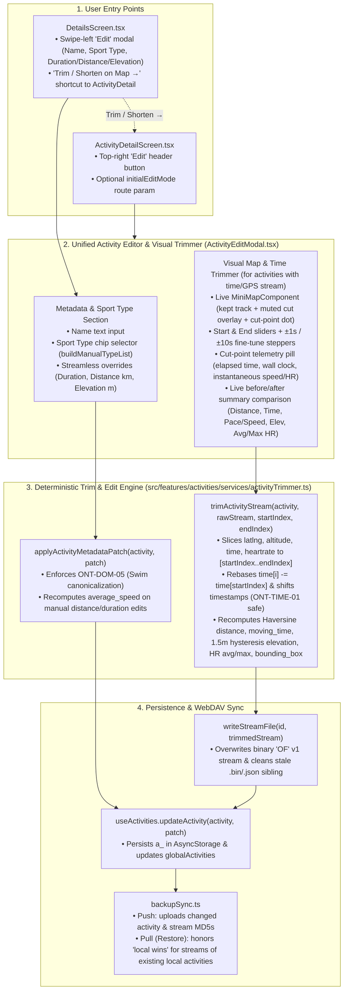

# Activity Editing & Visual GPS / Stream Trimming — Architecture, Ontology & Implementation Plan

This document specifies the end-to-end design for **Activity Editing & Visual Stream Trimming ("Crop Activity")** across **Offline Fitness**—allowing athletes to correct misconfigured recordings (changing sport type, name, or manual metrics) and visually trim the start and/or end of GPS-tracked and HR-streamed workouts while seeing the live map, cut-point telemetry, and recalculated summary stats.

---

## 1. Architectural Overview

---

## 2. Domain Model & Ontological Invariants (`docs/ontology.md`)

We will document the new editing and stream-trimming contracts in [docs/ontology.md](file:///Users/brunoorsier/dev/offline-fitness/docs/ontology.md):

### 2.1 `ONT-DOM-06` — Activity Metadata Mutation & Sport-Type Reclassification (`applyActivityMetadataPatch`)
1. **Sport Type Reclassification (`activity.type`):**
   - When an activity's `type` is changed to `'Swim'` (case-insensitive), `ONT-DOM-05` is enforced immediately at edit time: `moving_time = elapsed_time` and `total_elevation_gain = 0`.
   - When `distance` or `moving_time` / `elapsed_time` is edited on a streamless activity, `average_speed` is recomputed as $\text{distance} / \text{activeTimeSec}$ (or `0` when active time $\le 0$).
   - When an activity with a GPS track is reclassified to a `NO_GPS_ACTIVITY_TYPES` sport (or vice versa), its cached stream file on disk is preserved, while `isNoGpsActivity`-aware views (`MapsScreen`, distance tables, pace vs. speed formatters) dynamically adapt to the new `type`.

### 2.2 `ONT-KIN-09` — Deterministic Stream Trimming (`trimActivityStream`)
When trimming an activity with an aligned stream (`N` points, $0 \le \text{startIndex} < \text{endIndex} < N$):
1. **Series Slicing & Time Rebasing:**
   - All present series (`latlng`, `altitude`, `time`, `heartrate`) are sliced to `[startIndex, endIndex]` (inclusive, yielding $M = \text{endIndex} - \text{startIndex} + 1 \ge 2$ points).
   - Let $t_{\text{offset}} = \text{rawTime}[\text{startIndex}]$ (in seconds). Every kept time sample is rebased to $0$ at the new start:
     $$\text{time}'[k] = \text{rawTime}[\text{startIndex} + k] - t_{\text{offset}}$$
2. **Temporal Shifting on Start-Trim ($t_{\text{offset}} > 0$) (`ONT-TIME-01` Compliance):**
   - When $\text{startIndex} > 0$ ($t_{\text{offset}} > 0$):
     - `start_timestamp_utc` advances by $t_{\text{offset}} \times 1000\text{ ms}$.
     - `start_date_utc` is updated to `new Date(newStartUtcMs).toISOString()`.
     - Athlete-local wall-clock fields (`local_date`, `local_time`, `start_date_local`, `start_year`, `start_month`, `start_day`, `start_week`) are shifted by adding $t_{\text{offset}}$ seconds to the original athlete-local wall clock (derived via `utcms + utc_offset * 1000` in UTC arithmetic), **never** using ambient device `Date` getters, so historical timezones and DST offsets remain intact.
3. **Kinematic & Biometric Recalculation Over the Kept Window:**
   - **Distance (`distance`):** Sum of pairwise Haversine distances (`haversineDistance`) across kept `latlng` points (in meters, rounded to integer or `0` for GPS-less HR streams).
   - **Elapsed & Moving Time (`elapsed_time`, `moving_time`):**
     - $\text{elapsed\_time} = \max(1, \text{time}'[M - 1])$.
     - For `Swim` (`ONT-DOM-05`), $\text{moving\_time} = \text{elapsed\_time}$.
     - For GPS streams with `latlng` and `time`, each step $k \in [1, M - 1]$ has $\Delta t_k = \text{time}'[k] - \text{time}'[k - 1]$ and $\Delta d_k = \text{haversine}(\text{latlng}'[k-1], \text{latlng}'[k])$. A step counts toward `moving_time` when $0 < \Delta t_k \le 30\text{ s}$ and $\Delta d_k / \Delta t_k \ge v_{\text{min}}(\text{type})$ (stationary speed threshold from `PROFILE_FILTER_OPTIONS`), capped at $\text{elapsed\_time}$.
     - For GPS-less timer streams (`latlng` empty, `time` + `heartrate` present), $\text{moving\_time} = \text{elapsed\_time}$ (since timer recordings already exclude paused intervals during capture).
   - **Elevation (`total_elevation_gain`, `elev_high`, `elev_low`):**
     - `total_elevation_gain`: `0` for `Swim` or empty `altitude`; otherwise computed over `altitude'` using the canonical `1.5m` deadband hysteresis (`HYSTERESIS_THRESHOLD_BARO_M = 1.5`).
     - `elev_high` / `elev_low`: max and min of `altitude'` (or `0` if empty).
   - **Heart Rate (`average_heartrate`, `max_heartrate`):**
     - Computed over all non-`null` samples $> 0$ in `heartrate'` (or `undefined` if none remain).
   - **Spatial Bounds (`start_latlng`, `end_latlng`, `bounding_box`):**
     - `start_latlng = latlng'[0] ?? []`, `end_latlng = latlng'[M - 1] ?? []`, and `bounding_box = trackBoundingBox(latlng')`.

### 2.3 `ONT-STORE-03` — Stream File Canonicalization & "Local Wins" on Restore
- **Canonical Stream Filename & Stale Sibling Cleanup:**
  - `writeStreamFile(id, stream)` writes `<id>.json` (using the `'OF'` v1 binary codec, matching the filename expected by `pushBackup` in `backupSync.ts`) and removes any legacy `<id>.bin` sibling so `loadOneActivityStream`, `loadRawStreamForActivity`, and `pushBackup` all read the exact same file.
- **"Local Wins" for Streams on WebDAV Restore (`pullBackup`):**
  - When restoring from WebDAV (`pullBackup`), if an activity already exists locally (`localActivityIds.has(id)`) **and** its local stream file already exists on disk, `pullBackup` preserves the local stream file instead of overwriting it on an MD5 mismatch. Next `pushBackup` uploads the edited/trimmed local stream to WebDAV.

---

## 3. Step-by-Step Implementation Plan

### Step 1: Pure Trim & Metadata Patch Service (`src/features/activities/services/activityTrimmer.ts`)
Create a pure, well-tested service module with zero UI dependencies:
1. **`applyActivityMetadataPatch(activity: Activity, patch: ActivityMetadataPatch): Activity`**
   - Handles updates to `name`, `type`, and (for streamless activities) `durationSec`, `distanceMeters`, and `totalElevationGainM`.
   - Enforces `ONT-DOM-05` (`Swim` canonicalization) and recalculates `average_speed`.
2. **`computeCutPointMetrics(rawStream: StreamSet, index: number, activity: Activity): CutPointMetrics`**
   - Returns `{ index, elapsedSec, wallClockTime, coordinate: LatLng | null, altitudeM: number | null, heartRateBpm: number | null, speedKmh: number | null }` at `index` so the user can see instantaneous speed (e.g., spotting a `55 km/h` car ride at the end of a run) and exact wall-clock time while scrubbing.
3. **`previewTrimmedActivity(activity: Activity, rawStream: StreamSet, startIndex: number, endIndex: number): TrimPreviewResult`**
   - Synchronously computes the trimmed `Activity` record and summary deltas (`distanceMeters`, `elapsedTimeSec`, `movingTimeSec`, `elevationGainM`, `averageSpeedMps`, `averageHeartRate`, `maxHeartRate`) in $< 5\text{ ms}$ for live slider feedback.
4. **`trimActivityStream(activity: Activity, rawStream: StreamSet, startIndex: number, endIndex: number): { updatedActivity: Activity; trimmedStream: EncodableStreamSet }`**
   - Produces the final `Activity` record and `EncodableStreamSet` ready for `writeStreamFile` + `updateActivity`.
5. **`buildTrimPreviewStreams(rawStream: StreamSet, startIndex: number, endIndex: number, activityType: string): { keptStream: ActivityStream; cutStream: ActivityStream | undefined; activeCoordinate: LatLng | null }`**
   - Builds the `keptStream` (`[startIndex..endIndex]`) and the `cutStream` (the discarded head/tail segments) for `MiniMapComponent` so the user sees the kept path in `theme.primary` and the cut portion in a muted overlay colour (`theme.textMuted`), plus the `highlightCoordinate` dot at whichever handle (`start` or `end`) the user is actively moving.

---

### Step 2: Stream Storage & WebDAV Backup Alignment (`writeStreamFile.ts` & `backupSync.ts`)
1. **[`src/features/recording/services/writeStreamFile.ts`](file:///Users/brunoorsier/dev/offline-fitness/src/features/recording/services/writeStreamFile.ts):**
   - Write the `'OF'` v1 binary payload to `${id}.json` (the canonical extension listed by `backupSync.ts`) and delete `${id}.bin` if present so no stale sibling file can shadow the updated stream.
2. **[`src/features/backup/services/backupSync.ts`](file:///Users/brunoorsier/dev/offline-fitness/src/features/backup/services/backupSync.ts):**
   - In `pullBackup` (lines 711–732), check `if (existed && (localActivityIds.has(activityId) || await localStreamMatchesIndex(...)))` so that a locally trimmed stream for an existing local activity is never overwritten by an older remote copy during a Restore (`Option 4A`).

---

### Step 3: Unified Edit & Visual Trim Modal (`src/features/activities/components/ActivityEditModal.tsx`)
Create `ActivityEditModal.tsx` (and `ActivityEditModal.styles.ts`) supporting two tabs/sections:
1. **Details (Metadata & Sport Type):**
   - **Name:** `TextInput` prefilled with `activity.name`.
   - **Sport Type:** Horizontal chip list powered by [`buildManualTypeList`](file:///Users/brunoorsier/dev/offline-fitness/src/features/activities/services/manualActivity.ts#L71-L109) + `+ Custom` support.
   - **Metrics:**
     - If the activity has **no stream** (`!hasStream`): editable **Duration (minutes / seconds)**, **Distance (km)** (hidden for `isNoGpsActivity(selectedType)`), and **Elevation Gain (m)** (hidden for `Swim`).
     - If the activity **has a stream**: editable **Elevation Gain (m)** override (unless `Swim`), plus a prominent card/tab switch to **Trim / Shorten Recording**.
2. **Trim / Shorten (Visual Map + Time Scrubber):**
   - Automatically available whenever `rawStream` has $\ge 2$ points (`latlng` + `time` for GPS workouts, or `time` + `heartrate` for timer workouts like Yoga).
   - **Visual Map (when `latlng` is present):**
     - Renders `MiniMapComponent` (`allowFlyover={false}`) with:
       - `stream={keptStream}` (primary colour)
       - `overlayStream={cutStream}` (`overlayColor={theme.textMuted}`)
       - `highlightCoordinate={activeCutPoint.coordinate}`
   - **Active Handle Selector (`Trim End` vs. `Trim Start`):**
     - Defaults to **`Trim End`** (the 95% use case: forgot to stop recording).
     - Displays the cut-point telemetry bar:
       - **Time:** `00:42:15` (and wall-clock time `18:12:15`)
       - **Instantaneous Speed / Pace** at cut point (e.g. `11.4 km/h` or `52.0 km/h` when driving) and **HR** (`142 bpm`) if present.
     - **Slider + Fine-Tune Steppers (`-10s`, `-1s`, `+1s`, `+10s`, `Reset`):**
       - Smoothly scrubs `endIndex` (or `startIndex`), enforcing `startIndex < endIndex`.
   - **Live Before $\to$ After Summary Card:**
     - Side-by-side comparison of **Distance** (`12.40 km → 10.12 km`), **Duration** (`1:05:20 → 0:48:10`), **Avg Pace / Speed**, **Elevation Gain**, and (if present) **Avg / Max HR**.
   - **Confirmation on Destructive Trim:**
     - If `startIndex > 0` or `endIndex < totalPoints - 1`, tapping **Save** prompts a confirmation alert (`"Trim recording?"`, `"This permanently removes X:XX from the activity stream."`) before writing the trimmed stream and updating the activity.

---

### Step 4: Integrate Into `ActivityDetailScreen` and `DetailsScreen`
1. **[`src/shared/types/types.ts`](file:///Users/brunoorsier/dev/offline-fitness/src/shared/types/types.ts):**
   - Extend `RootStackParamList['ActivityDetail']` to `{ activityId: string; openEdit?: 'details' | 'trim' }`.
2. **[`src/features/activities/screens/ActivityDetailScreen.tsx`](file:///Users/brunoorsier/dev/offline-fitness/src/features/activities/screens/ActivityDetailScreen.tsx):**
   - Add an **Edit** button (`Ionicons name="create-outline"`) in `navigation.setOptions({ headerRight })`.
   - Load `rawStream` when the Edit modal opens (and pass a `streamVersion` counter down to `ActivityAnalysisView` / `useLoadedStream` so `ActivityAnalysisView` immediately reloads the newly trimmed stream from disk after save).
   - Auto-open the Edit modal in `'trim'` mode when navigated with `route.params?.openEdit === 'trim'`.
3. **[`src/features/activities/screens/DetailsScreen.tsx`](file:///Users/brunoorsier/dev/offline-fitness/src/features/activities/screens/DetailsScreen.tsx):**
   - Upgrade `EditActivityModal` (opened via swipe-left **Edit**) to support:
     - **Name**
     - **Sport Type** chip selector (`buildManualTypeList`)
     - **Duration (min)** & **Distance (km)** (for streamless activities) + **Elevation gain (m)**
     - **"Trim / Shorten on Map →"** button (`Option 3A`) that closes the quick sheet and calls `navigation.navigate(STACK_ROUTES.ActivityDetail, { activityId: activity.id, openEdit: 'trim' })`.

---

### Step 5: Verification & Quality Gates
1. **Unit & Component Tests:**
   - `__tests__/activities/activityTrimmer.spec.ts`:
     - Trimming tail only (`startIndex = 0, endIndex < N - 1`): verifies distance, elapsed/moving time, elevation hysteresis, HR avg/max, and unchanged `start_timestamp_utc`.
     - Trimming start (`startIndex > 0`): verifies `time` rebasing to `0`, `start_timestamp_utc` and `local_date`/`local_time` shift (`ONT-TIME-01` safe across non-device timezones), and new `start_latlng`.
     - Trimming GPS-less HR stream (e.g., Yoga timer recording): verifies `time` + `heartrate` slicing and `average_heartrate` / `max_heartrate` recalculation.
     - Metadata patching (`applyActivityMetadataPatch`): verifies sport type change, `Swim` canonicalization (`ONT-DOM-05`), and streamless duration/distance speed recalculation.
   - `__tests__/activities/ActivityEditModal.spec.tsx`:
     - Tests metadata editing, sport type chip selection, Start/End trim controls, fine-tune steppers (`-10s`, `+10s`), live preview readout, and save flow.
   - Update `__tests__/backupPull.spec.ts` to verify that `pullBackup` preserves local streams for existing local activities (`Option 4A`).
2. **Codebase Memory & Ontology:**
   - Update [docs/ontology.md](file:///Users/brunoorsier/dev/offline-fitness/docs/ontology.md) with `ONT-DOM-06`, `ONT-KIN-09`, and `ONT-STORE-03`.
   - Re-index `codebase-memory-mcp`.
3. **Full Definition-of-Done Gate:**
   - `npx expo lint --fix`
   - `npx tsc --noEmit`
   - `npm run check:imports`
   - `npm run check:mobile-only`
   - `npm run check:install-scripts`
   - `npm test -- --watchAll=false`
   - `scripts/sonar_gate.sh --scan` (0 open issues)
