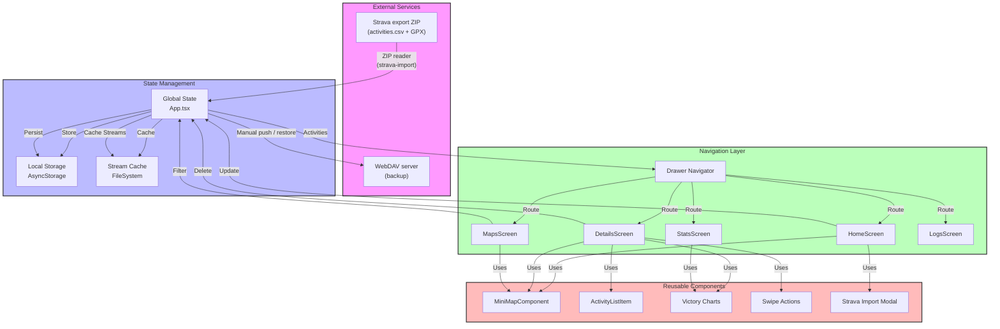

# Offline Fitness Architecture

This document describes the system architecture of the Offline Fitness application, including data flow, component hierarchy, state management, and import best practices.

## Key Architectural Principles

1. **Modular Feature Structure**: Code is organized by features (activities, backup, strava-import, maps, stats, home) with each feature containing its own components, services, screens, and types. The `backup` feature mirrors local activities/streams to a WebDAV server (manual push/pull, no auto-sync). The `strava-import` feature builds the same local activities/streams from a Strava data-export ZIP, with no API or OAuth involved — it is the **only** ingestion path.

2. **Barrel Exports with Careful Dependency Management**: Each module exposes a public API through barrel exports (index.ts), but internal module imports use relative paths to prevent circular dependencies.

3. **Shared Module for Cross-Cutting Concerns**: Common components, services, utilities, and types are centralized in the shared module.

4. **Direct Imports for Known Circular Dependencies**: Certain components and services that would create circular dependencies are imported directly rather than through barrel exports.

5. **Clean Architecture Layers**: Clear separation between UI components, business logic services, and data management.

6. **A Theme Module for Colours**: All colours come from `src/theme/` — see [Theme Support](#theme-support). Components read them through `useTheme()`; there are no colour literals outside the theme module.

## WebDAV backup layout

The backup feature stores every file below a per-app, per-athlete collection, so
that two apps — or two athletes sharing one server account — never write into the
same folder:

```
<account root>/               e.g. https://host/remote.php/dav/files/<user>/
  offline-fitness/            app id, fixed in code (APP_CONFIG.BACKUP_APP_ID)
    <profile>/                athlete label, chosen by the user (required)
      collection.json         app id + profile that own this folder
      activities/<id>.json    activity JSON
      streams/<id>.json       stream JSON
      sync-state.json         md5 index + deletion tombstones
```

- The user types the **account root**; the app composes the collection from it
  (`collectionUrlFor()` in `services/webdavAuth.ts`).
- The **profile** identifies the athlete, not the device: the same person on two
  phones uses the same label, so they share one backup and a restore onto a new
  phone finds the old phone's data. People sharing one account each pick their
  own label. The label is required and restricted to letters, digits, dots,
  dashes and underscores.
- `collection.json` is written on the first sync and verified on every later
  push and restore. A folder owned by another app id or profile is refused
  rather than mixed — this is what stops two athletes who picked the same
  default label from sharing one index (the index lists every activity id, so a
  shared one would restore the wrong activities).
- The app id must stay stable across releases: renaming it would orphan every
  backup written under the old name.

## System Overview



## Legend

- 🟪 External Services (Pink): Third-party integrations
- 🟦 State Management (Blue): Data and state handling
- 🟩 Navigation (Green): Screen routing and navigation
- 🟥 Components (Red): Reusable UI components

## Key Features

1. **Global State Management**
   - Centralized in App.tsx
   - Manages activities and app state
   - Handles data persistence

2. **Data Storage**
   - AsyncStorage for activities
   - FileSystem for stream caching
   - No authentication state: the app is fully offline after the archive import

3. **Navigation**
   - Drawer-based navigation
   - Five main screens
   - Consistent routing

4. **Component Architecture**
   - Reusable components
   - Shared map functionality
   - Common UI elements

5. **Data Flow**
   - Strava export ZIP import (`activities.csv` + GPX → same local records and stream cache)
   - Local caching
   - State updates

6. **Strava Archive Import** (`src/features/strava-import`)
   - Entry point: drawer item "Import Strava Export" → `StravaImportModal`, which needs no Strava connection.
   - `services/zipReader.ts` — random-access ZIP reader over `expo-file-system` `FileHandle` (seek + `readBytes`) with `pako` for deflate/gzip. A full export is ~1 GB uncompressed, so the archive is never loaded whole: peak memory is one central-directory listing plus a single track file. Supports stored/deflate entries and ZIP64.
   - `services/csvParser.ts` — locale-tolerant `activities.csv` parser. Header names follow the account language, so columns resolve by alias (English/French/major European abbreviations) with the known column layout as a verified fallback. `Distance` and `Elapsed Time` appear twice; the later (metres/seconds) occurrence wins. Activity dates are UTC.
   - `services/gpxParser.ts` — regex GPX reader producing `latlng`/`altitude`/`time` streams in the exact API shape, so maps, charts, bounding boxes and export work unchanged.
   - `services/activityMapper.ts` — UTC → athlete-local conversion (`local_date`/`local_time`, `start_week`, `utc_offset`) using the device timezone, since the archive has no timezone column.
   - `services/importStravaExport.ts` — two passes: persist activities in batches (usable immediately), then convert tracks one at a time, skipping stream files that already exist (idempotent, resumable). `.fit`/`.tcx` files are counted as unsupported; activities without GPS get a `nostreamflag`.
   - Direct import exception: the pipeline imports `compressStreamSet` from `@/features/activities/services/fetchAndStoreStreams` rather than the barrel, because the barrel pulls in React Native screens and list components.

7. **Import Structure & Best Practices**

   ### Barrel Exports Usage
   - All features, shared components, and constants use barrel exports
   - Import from feature roots: `@/features/activities`, `@/features/strava-import`, etc.
   - Import from shared: `@/shared` for components, services, types, and utils
   - Import from constants: `@/constants` for colors and configuration

   ### Circular Dependency Prevention Rules

   **1. Intra-Module Imports (Within Same Module)**
   - NEVER import from your own module's barrel export
   - ALWAYS use relative imports: `../services/streamCache`, `./types/activities.types`
   - This prevents self-referential circular dependencies

   **2. Inter-Module Imports (Between Different Modules)**
   - USE barrel exports when there are no circular dependencies
   - USE direct imports when barrel exports would create cycles
   - Check for circular patterns like: A → B → C → A

   **3. Shared Module Rules**
   - Services in shared that import from feature modules MUST NOT be in barrel exports
   - Components that are imported by multiple features should be evaluated for cycles
   - If a shared service needs a feature module, it creates a circular dependency

   **4. Asset Imports**
   - Always use relative paths for assets (images, SVGs, etc.)
   - Never include assets in barrel exports

   ### Known Circular Dependency Exceptions

   These items must be imported directly, not through barrel exports:

   **Components:**
   - `CustomDrawer` from `@/shared/components/CustomDrawer`
   - `MiniMapComponent` from `@/features/maps/components/MiniMapComponent`
   - `ButtonList` from `@/features/home/components/ButtonList`

   **Services:**
   - `trackComparison` functions from `@/shared/services/trackComparison` (import directly)

   ### Examples

   **✅ Correct Patterns:**

   ```typescript
   // Within activities module
   import { StreamSet } from '../types/stravaActivityStream.model';
   import { compressStreamSet } from './fetchAndStoreStreams';

   // From another module
   import { useActivitiesContext } from '@/features/activities';
   import { simpleLogger } from '@/shared';

   // Direct import to avoid circular dependency
   import MiniMapComponent from '@/features/maps/components/MiniMapComponent';
   ```

   **❌ Incorrect Patterns:**

   ```typescript
   // Within activities module - DON'T DO THIS
   import { ResponseActivityType } from '@/features/activities';

   // Barrel export of circular dependency - DON'T DO THIS
   // In shared/index.ts
   export { findSimilarActivitiesByTrack } from './services/trackComparison'; // if trackComparison imports from features
   ```

   ### Testing for Circular Dependencies
   - Run the build and check for "Require cycle" warnings
   - If you see a cycle, trace the import chain and break it with direct imports
   - Common signs: "useContext is not a function", undefined exports

   ### Quick Import Decision Guide

   When importing a module, ask yourself:
   1. **Am I importing from within the same feature module?**
      → Use relative imports (`../`, `./`)
   2. **Am I importing from a different feature/shared module?**
      → Try barrel export first (`@/features/xxx`, `@/shared`)
      → If you get a circular dependency warning, switch to direct import
   3. **Am I importing an asset (image, SVG, etc.)?**
      → Always use relative paths
   4. **Is this a known problematic import?**
      → Check the exceptions list above and use direct import
   5. **Am I creating a service in shared that needs a feature module?**
      → Don't add it to the barrel export

## Summary

The Offline Fitness architecture prioritizes:

- **Modularity**: Features are self-contained with clear boundaries
- **Maintainability**: Barrel exports reduce import verbosity while avoiding circular dependencies
- **Scalability**: New features can be added without affecting existing modules
- **Type Safety**: TypeScript throughout with strict mode enabled
- **Performance**: Lazy loading, memoization, and efficient data structures

By following these architectural patterns and import guidelines, the codebase remains clean, maintainable, and free from circular dependency issues.

## Theme Support

The app's colours come from a **theme layer** in `src/theme/`, not from module-level constants. A *palette* holds only the chromatic choices (brand accent, success tone, chart series, quarter tints); the neutral ramp, surfaces, lines and text ramp are **shared by every palette**, so switching palette never reflows the layout or changes the reading experience — only the accent changes.

```
src/theme/
├── types.ts           PaletteDefinition, ResolvedTheme, SchemeColor
├── palettes.ts        the registry: legacy, twilight, alpine, terracotta, crimson
├── resolve.ts         palette + colour scheme → resolved tokens
├── ThemeProvider.tsx  holds the active palette, persists it, exposes context
├── useTheme.ts        const theme = useTheme()
├── chartTheme.ts      createVictoryTheme(theme) for the Victory charts
└── navigationTheme.ts createNavigationTheme(theme) for React Navigation
```

- **Reading colours**: components call `useTheme()` and read `theme.primary`, `theme.success`, `theme.surface`, `theme.text`, `theme.chartSeries`, … Module-level `StyleSheet.create` freezes colours at import time and cannot follow a palette, so styles are built by a `createStyles(theme)` function and memoised on the theme.
- **Colour scheme**: follows the device setting through `useColorScheme()` inside `ThemeProvider`. `app.json` currently pins `userInterfaceStyle` to `"light"`, so the app does not yet follow the system theme.
- **Charts**: `createChartTheme(theme)` derives the Victory axis, grid, tick-label and legend colours from the same tokens, so charts no longer keep Material's own greys and blue accents.
- **Navigation**: `createNavigationTheme(theme)` feeds the same tokens to React Navigation, so the drawer and the bottom tab bar take their active/inactive tints from the active palette.
- **Adding a palette**: define it in `palettes.ts` and add its id to `PALETTE_ORDER`. It then appears in the picker automatically. `__tests__/theme/theme.spec.ts` checks every registered palette against the accessibility floor (4.5:1 for text and labels, 3:1 for chart fills) and that the palette the app starts on meets it.
- **The picker**: `PalettePicker` (`src/theme/PalettePicker.tsx`) lists the registered palettes, applies the choice immediately and lets the provider persist it (`paletteId` in AsyncStorage). It is surfaced in the Stats settings modal under **Appearance**. Each row previews the palette it stands for — the swatch is the brand accent and the dots are the first entries of its chart series, in the colour scheme currently in use.

If dark theme appears not to work, ensure:

1. Device system theme is properly set
2. `app.json` has `userInterfaceStyle` set to `"automatic"`
3. The app has been refreshed/rebuilt after the change
4. All text and background colors come from `useTheme()`
