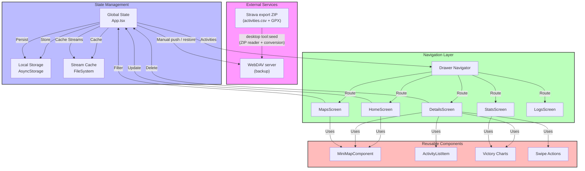

# Offline Fitness Architecture

This document describes the system architecture of the Offline Fitness application, including data flow, component hierarchy, state management, and import best practices.

## Key Architectural Principles

1. **Modular Feature Structure**: Code is organized by features (activities, backup, strava-import, maps, stats, home, recording) with each feature containing its own components, services, screens, and types. The `recording` feature wraps a local Expo module (`modules/gps-tracker/`) that owns the foreground service, the fix log and the replay; the app only owns permissions, the UI and the save flow. The `backup` feature mirrors local activities/streams to a WebDAV server (manual push/pull, no auto-sync). The `strava-import` feature is the Strava data-export conversion core — no API or OAuth involved — and since Phase 5 it is executed by the desktop tool (`npm run tool:seed`), which writes the WebDAV collection that the phone's _Restore_ ingests; there is no in-app archive import any more (see `docs/desktop-import-plan.md`).

2. **Barrel Exports with Careful Dependency Management**: Each module exposes a public API through barrel exports (index.ts), but internal module imports use relative paths to prevent circular dependencies.

3. **Shared Module for Cross-Cutting Concerns**: Common components, services, utilities, and types are centralized in the shared module.

4. **Direct Imports for Known Circular Dependencies**: Certain components and services that would create circular dependencies are imported directly rather than through barrel exports.

5. **Clean Architecture Layers**: Clear separation between UI components, business logic services, and data management.

6. **A Theme Module for Colours**: All colours come from `src/theme/` — see [Theme Support](#theme-support). Components read them through `useTheme()`; there are no colour literals outside the theme module.

## WebDAV backup layout

The backup feature stores every file below a per-app, per-athlete collection, so
that two apps — or two athletes sharing one server account — never write into the
same folder:

```
<account root>/               e.g. https://host/remote.php/dav/files/<user>/
  offline-fitness/            app id, fixed in code (APP_CONFIG.BACKUP_APP_ID)
    <profile>/                athlete label, chosen by the user (required)
      collection.json         app id + profile + layout version that own this folder
      activities/<id>.json    activity JSON
      streams/<id>.json       stream file (layout 2: binary 'OF' v1 payload)
      sync-state.json         md5 index + deletion tombstones
```

- The user types the **account root**; the app composes the collection from it
  (`collectionUrlFor()` in `services/webdavAuth.ts`).
- The **profile** identifies the athlete, not the device: the same person on two
  phones uses the same label, so they share one backup and a restore onto a new
  phone finds the old phone's data. People sharing one account each pick their
  own label. The label is required and restricted to letters, digits, dots,
  dashes and underscores.
- `collection.json` is written on the first sync and verified on every later
  push and restore. A folder owned by another app id or profile is refused
  rather than mixed — this is what stops two athletes who picked the same
  default label from sharing one index (the index lists every activity id, so a
  shared one would restore the wrong activities).
- The marker also carries **`schemaVersion`**, the layout contract of everything
  below it (`APP_CONFIG.BACKUP_SCHEMA_VERSION`, currently `2` = binary stream
  payloads; `1` was JSON). A folder written in a layout this build does not
  understand is refused on both push and restore rather than half-restored: the
  remote index lists files whose payload the reading app cannot interpret. Bump
  the constant whenever the payload encoding, folder layout, file naming or
  sync-state shape changes incompatibly. It is distinct from the per-file codec
  version byte inside a stream file — that describes one payload, this describes
  the whole folder. A marker predating versioning is read as layout 1; an
  _absent_ marker is deliberately not a version refusal (a fresh folder has
  none: pushing claims it, restoring from it has nothing to fetch). **Any writer
  other than the app — e.g. a desktop import tool that fills a collection
  directly — must write this marker with the current `schemaVersion`, or the
  phone refuses to sync with it.**
- The app id must stay stable across releases: renaming it would orphan every
  backup written under the old name.

## System Overview



## Legend

- 🟪 External Services (Pink): Third-party integrations
- 🟦 State Management (Blue): Data and state handling
- 🟩 Navigation (Green): Screen routing and navigation
- 🟥 Components (Red): Reusable UI components

## Key Features

1. **Global State Management**
   - Centralized in App.tsx
   - Manages activities and app state
   - Handles data persistence

2. **Data Storage**
   - AsyncStorage for activities
   - FileSystem for stream caching and the recording fix logs (`<files>/recording/<sessionId>/`)
   - No authentication state: the app is fully offline after the archive import

3. **Navigation**
   - Drawer-based navigation
   - Six main screens (Home, Record, Stats, Maps, Activities, Logs)
   - Consistent routing
   - The `Record` screen drives the local `gps-tracker` module; the `Add activity` drawer item opens the RECORD-CHOOSER.

4. **Component Architecture**
   - Reusable components
   - Shared map functionality
   - Common UI elements

5. **Data Flow**
   - Strava export ZIP import (`activities.csv` + GPX → same local records and stream cache) via the desktop seeder (`npm run tool:seed`) + phone Restore
   - On-device recording (Android): raw fixes → `fixes.jsonl` → TypeScript replay → `Activity` + binary stream, stored and pushed like an imported one
   - Local caching
   - State updates

6. **GPS Recording** (`src/features/recording`, `modules/gps-tracker/`)
   - The only ingestion path that originates on the phone. A local Expo module (`modules/gps-tracker/`) owns the foreground service (`foregroundServiceType="location"`), the wake lock, the notification, the location providers, the session storage and the fix log; the app owns permissions (D5), the UI and the save flow. The module is autolinked from `modules/` via `app.json` → `expo.autolinking.nativeModulesDir`, with no `package.json`, no lockfile entry and no symlink.
   - **Typed surface**: `AsyncFunction`/`Events`/`OnStartObserving` replace the legacy `ReadableMap` parsing and the mutable `TrackingService.listener` static. The module holds no session state: the service publishes through `TrackingSession` (a process-wide holder) and the module subscribes, so a destroyed React instance cannot lose a recording (§4 of `docs/recording-plan.md`).
   - **The fix log is the contract, not GPX** (D3): `<files>/recording/<sessionId>/meta.json` + `fixes.jsonl`. Native captures and persists raw fixes; the app reads the log itself in chunks (D11) through `services/fixLog.ts` and replays it in TypeScript (`services/replaySession.ts`). **No fix array crosses the bridge.**
   - **Canonical replay in TypeScript** (D2): `replaySession` folds fixes one at a time into a reducer (accuracy ceiling → min distance → speed-jump → stale timestamp → interval → stationary drift → altitude fusion → auto-pause → manual-pause time). Distance, gain, loss, max speed, elapsed, moving time, average speed and the moving segments all come out of it. Coordinates are rounded to 1e-6 and altitude to 0.1 m, matching `toStreamSet`, so a recorded activity and an imported one produce the same payload and the map, charts and stats treat them identically.
   - **Swims are canonicalised at write time**: `moving_time = elapsed_time` and `total_elevation_gain = 0`, matching `rowToActivity`/`correctSwimElevationGain`, so a recorded swim is never "fixed" by the startup backfill.
   - **Altitude**: the native `AltitudeProcessor` reports raw altitude + geoid + pressure only; the barometer fusion, EMA smoothing, hysteresis gain/loss and slope live in the replay.
   - **Save order** (§3.7, retryable): replay → `writeStreamFile` (`encodeStreamSet` + `File.write` into `APP_CONFIG.STREAMS_FOLDER`) → `addActivity` (which triggers the existing backup sync) → `markSessionSaved`. A failure after the stream write leaves an unreferenced file (harmless, overwritten on retry).
   - **Android-only recording** (D6/D7): iOS is a compiled stub answering `getCapabilities() → { canRecord: false }`. The pod resolves and the stub compiles (`xcodebuild -scheme GpsTracker`), so the module cannot quietly become Android-only at the config level.
   - **No `ACCESS_BACKGROUND_LOCATION`** (D5): a `foregroundServiceType="location"` service started while the app is visible runs on the while-in-use grant. `REQUEST_IGNORE_BATTERY_OPTIMIZATIONS` is available opt-in from the global Settings modal for devices that aggressively throttle background recording.
   - **Permissions are the app's job** (D5): foreground location via `expo-location`, `POST_NOTIFICATIONS` via `PermissionsAndroid`; denial of the notification is non-fatal. `useKeepAwake` keeps the screen on only while a session is live.

7. **Heart-Rate Capture & BLE Integration** (`src/features/heart-rate`, `modules/heart-rate/`)
   - Captures heart rate from Bluetooth Low Energy straps conforming to the standard BLE Heart Rate Service (`0x180D`), Measurement (`0x2A37`), and Battery (`0x2A19`). Tested with the Polar H10.
   - **Local Expo Module** (`modules/heart-rate/`): Android implementation manages device discovery, GATT connections, notifications, and battery status. Clean lifecycle management cancels scanners and coroutine scopes in `onDestroy()`. iOS is implemented as an explicit capability stub (`canScan: false`).
   - **Permissions**: Bluetooth permissions are declared directly in the native module's manifest (`BLUETOOTH_SCAN` and `BLUETOOTH_CONNECT` with `neverForLocation` for Android 12+, falling back to `ACCESS_FINE_LOCATION` on legacy Android). The app manifest remains free of duplicate declarations.
   - **Session Logging & Alignment**: While an activity session is active, incoming HR samples are appended as JSONL records to `<files>/recording/<sessionId>/heartrate.jsonl`. Replay correlates samples within a ±10 s window against accepted track fixes. Fixes without nearby samples or with sensor contact lost receive `null` (never `0` bpm) so that gaps and real readings are clearly distinguishable.
   - **Stream Codec**: The binary stream encoder flags heart rate via `FLAG_HAS_HEARTRATE` and verifies length alignment. Missing samples (`null`) are serialized as a dedicated `0` sentinel value on disk and restored to `null` in memory.
   - **Retention** (D10): fix logs are kept for 30 days, device-only, swept at app start and after each successful save through `listSessions()` + `discardSession()`, and deleted immediately when the corresponding `recorded-*` activity is deleted; the README Fine print states the window.
   - **iOS contribution guide**: the stub is the contract; implement the same functions behind `CoreLocation` and validate against the fixtures in `__tests__/recording/`.

8. **Strava Archive Conversion** (`src/features/strava-import`, run by `scripts/strava-import-tool/`)
   - Entry point: `npm run tool:seed` on a computer (Phase 5 of `docs/desktop-import-plan.md` retired the in-app importer — no Strava connection either way). Nothing under `src/` imports this feature; it is the library the tool runs, so the phone keeps its byte-identity guarantee with the collection.
   - `services/zipReader.ts` — random-access ZIP reader over a plain `ByteSource` seam (seek + read a byte range), with `pako` for deflate/gzip. A full export is ~1 GB uncompressed, so the archive is never loaded whole: peak memory is one central-directory listing plus a single track file. Supports stored/deflate entries and ZIP64.
   - `services/csvParser.ts` — locale-tolerant `activities.csv` parser. Header names follow the account language, so columns resolve by alias (English/French/major European abbreviations) with the known column layout as a verified fallback. `Distance` and `Elapsed Time` appear twice; the later (metres/seconds) occurrence wins. Activity dates are UTC.
   - `services/gpxParser.ts` — regex GPX reader producing `latlng`/`altitude`/`time` streams in the exact API shape, so maps, charts, bounding boxes and export work unchanged.
   - `services/activityMapper.ts` — UTC → athlete-local conversion (`local_date`/`local_time`, `start_week`, `utc_offset`) via `utcToLocalParts(utcMs, zone)` — the zone is a parameter (`Intl.formatToParts`, never the machine's ambient zone), because the tool derives it per activity from the track's GPS start. Swims are canonicalised at write time (`applySwimMovingTime`: meaningless `moving_time` replaced, gain forced to 0), so the writer stores and the backup push hashes the same record.
   - The orchestration that used to live in `services/importStravaExport.ts` (two passes, batched writes, live-state UI, `nostreamflag` files) is retired with the phone importer; `scripts/strava-import-tool/seed.ts` is its desktop counterpart (marker claimed first, `sync-state.json` written last, md5 skips, 8-way pool, zone per GPS start, aborts on 10 unreadable tracks). Stream files (`streams/<id>.json`) are encoded with `encodeStreamSet` (`src/shared/services/streamCodec.ts`) into a compact 16 B/point binary format (`'OF'` magic header + little-endian `int32` arrays); on the phone `readStreamFile` transparently reads binary and legacy JSON files, and _Restore_ writes raw bytes.
   - **Portable import core** (Phase 0 of `docs/desktop-import-plan.md`): the conversion code the desktop tool reuses — `csvParser`, `gpxParser`, `textDecode`, `activityMapper`, `entryNames`, `zipReader`, `types/import.types`, `shared/services/streamCodec` (the binary payload codec), `shared/services/SimpleLogger`, `backup/services/webdavTransport`, `@/constants` and the utils/types they reach — carries no expo or React Native _value_ imports. In practice: `activityMapper` takes `week_of_year` from `@/shared/utils/utils` and types from `@/shared/types/types` directly (never the `@/shared` barrel, which re-exports RN components), `utils.ts` does likewise, and `types.ts` spells its navigation import `import type` so it is erased at build time. The guard is `__tests__/stravaImport/importCorePortability.spec.ts`, a static check that fails the day a barrel or platform import creeps back into the graph; it covers the tool's own modules (`scripts/strava-import-tool/`) by the same rules, and its Phase 5 scan refuses any reference to the deleted in-app importer inside `src/`.
   - **Desktop seeder** (`npm run tool:seed`, `scripts/strava-import-tool/`): converts a Strava export ZIP into a WebDAV backup collection on a computer — the only ingestion path — so the archive never touches the phone, which only runs _Restore_. It reuses the app's own conversion graph _and_ its `webdavTransport`, which makes the tool's files byte-identical to what the phone pushes — the md5 dedup then skips them. Contract details (marker with `schemaVersion` claimed first, `sync-state.json` written last, tombstones honored, zone per GPS start with `--tz` fallback) are asserted in `__tests__/desktopImport/`; see `docs/desktop-import-plan.md`.

9. **User Profile** (`src/features/profile/`)
   - A dedicated drawer screen (`ProfileScreen`) storing optional physiology data in device-local AsyncStorage under the `userProfile` key: optional `age` (years) and a `weightEntries` array of `{ date: YYYY-MM-DD, weightKg }` tuples (newest first, de-duplicated by date). Kept device-local (not in the WebDAV collection) so it stays optional and private.
   - Provides manual entry (add/delete weight entries, default date = today) plus an "Import CSV" modal that parses pasted `date,weight` rows (header ignored, per-date replace) — paste-based to avoid a native file picker.
   - Consumers (HR zones, calories, TRIMP, predicted max HR) should read `loadUserProfile()` and gate features behind presence of the required value.

10. **Import Structure & Best Practices**

   ### Barrel Exports Usage
   - All features, shared components, and constants use barrel exports
   - Import from feature roots: `@/features/activities`, `@/features/strava-import`, etc.
   - Import from shared: `@/shared` for components, services, types, and utils
   - Import from constants: `@/constants` for colors and configuration

   ### Circular Dependency Prevention Rules

   **1. Intra-Module Imports (Within Same Module)**
   - NEVER import from your own module's barrel export
   - ALWAYS use relative imports: `../services/streamCache`, `./types/activities.types`
   - This prevents self-referential circular dependencies

   **2. Inter-Module Imports (Between Different Modules)**
   - USE barrel exports when there are no circular dependencies
   - USE direct imports when barrel exports would create cycles
   - Check for circular patterns like: A → B → C → A

   **3. Shared Module Rules**
   - Services in shared that import from feature modules MUST NOT be in barrel exports
   - Components that are imported by multiple features should be evaluated for cycles
   - If a shared service needs a feature module, it creates a circular dependency

   **4. Asset Imports**
   - Always use relative paths for assets (images, SVGs, etc.)
   - Never include assets in barrel exports

   ### Known Circular Dependency Exceptions

   These items must be imported directly, not through barrel exports:

   **Components:**
   - `CustomDrawer` from `@/shared/components/CustomDrawer`
   - `MiniMapComponent` from `@/features/maps/components/MiniMapComponent`
   - `ButtonList` from `@/features/home/components/ButtonList`
   - `RecordChooserSheet` from `@/features/activities/components/RecordChooserSheet` (mounted beside the navigator, never inside the drawer panel)
   - `RecordingScreen` from `@/features/recording/screens/RecordingScreen`

   **Services:**
   - `trackComparison` functions from `@/shared/services/trackComparison` (import directly)

   ### Examples

   **✅ Correct Patterns:**

   ```typescript
   // Within activities module
   import { StreamSet } from '../types/stravaActivityStream.model';
   import { compressStreamSet } from './fetchAndStoreStreams';

   // From another module
   import { useActivitiesContext } from '@/features/activities';
   import { simpleLogger } from '@/shared';

   // Direct import to avoid circular dependency
   import MiniMapComponent from '@/features/maps/components/MiniMapComponent';
   ```

   **❌ Incorrect Patterns:**

   ```typescript
   // Within activities module - DON'T DO THIS
   import { ResponseActivityType } from '@/features/activities';

   // Barrel export of circular dependency - DON'T DO THIS
   // In shared/index.ts
   export { findSimilarActivitiesByTrack } from './services/trackComparison'; // if trackComparison imports from features
   ```

   ### Testing for Circular Dependencies
   - Run the build and check for "Require cycle" warnings
   - If you see a cycle, trace the import chain and break it with direct imports
   - Common signs: "useContext is not a function", undefined exports

   ### Quick Import Decision Guide

   When importing a module, ask yourself:
   1. **Am I importing from within the same feature module?**
      → Use relative imports (`../`, `./`)
   2. **Am I importing from a different feature/shared module?**
      → Try barrel export first (`@/features/xxx`, `@/shared`)
      → If you get a circular dependency warning, switch to direct import
   3. **Am I importing an asset (image, SVG, etc.)?**
      → Always use relative paths
   4. **Is this a known problematic import?**
      → Check the exceptions list above and use direct import
   5. **Am I creating a service in shared that needs a feature module?**
      → Don't add it to the barrel export

## Summary

The Offline Fitness architecture prioritizes:

- **Modularity**: Features are self-contained with clear boundaries
- **Maintainability**: Barrel exports reduce import verbosity while avoiding circular dependencies
- **Scalability**: New features can be added without affecting existing modules
- **Type Safety**: TypeScript throughout with strict mode enabled
- **Performance**: Lazy loading, memoization, and efficient data structures

By following these architectural patterns and import guidelines, the codebase remains clean, maintainable, and free from circular dependency issues.

## Theme Support

The app's colours come from a **theme layer** in `src/theme/`, not from module-level constants. A _palette_ holds only the chromatic choices (brand accent, success tone, chart series, quarter tints); the neutral ramp, surfaces, lines and text ramp are **shared by every palette**, so switching palette never reflows the layout or changes the reading experience — only the accent changes.

```
src/theme/
├── types.ts           PaletteDefinition, ResolvedTheme, SchemeColor
├── palettes.ts        the registry: legacy, twilight, alpine, terracotta, crimson
├── resolve.ts         palette + colour scheme → resolved tokens
├── ThemeProvider.tsx  holds the active palette, persists it, exposes context
├── useTheme.ts        const theme = useTheme()
├── chartTheme.ts      createVictoryTheme(theme) for the Victory charts
└── navigationTheme.ts createNavigationTheme(theme) for React Navigation
```

- **Reading colours**: components call `useTheme()` and read `theme.primary`, `theme.success`, `theme.surface`, `theme.text`, `theme.chartSeries`, … Module-level `StyleSheet.create` freezes colours at import time and cannot follow a palette, so styles are built by a `createStyles(theme)` function and memoised on the theme.
- **Colour scheme**: follows the device setting through `useColorScheme()` inside `ThemeProvider`. `app.json` currently pins `userInterfaceStyle` to `"light"`, so the app does not yet follow the system theme.
- **Charts**: `createChartTheme(theme)` derives the Victory axis, grid, tick-label and legend colours from the same tokens, so charts no longer keep Material's own greys and blue accents.
- **Navigation**: `createNavigationTheme(theme)` feeds the same tokens to React Navigation, so the drawer and the bottom tab bar take their active/inactive tints from the active palette.
- **Adding a palette**: define it in `palettes.ts` and add its id to `PALETTE_ORDER`. It then appears in the picker automatically. `__tests__/theme/theme.spec.ts` checks every registered palette against the accessibility floor (4.5:1 for text and labels, 3:1 for chart fills) and that the palette the app starts on meets it.
- **The picker**: `PalettePicker` (`src/theme/PalettePicker.tsx`) lists the registered palettes, applies the choice immediately and lets the provider persist it (`paletteId` in AsyncStorage). It is surfaced in the app's Settings (`src/shared/components/SettingsModal.tsx`, reached from the drawer's **Settings** item) alongside the WebDAV backup — not in the Stats settings modal, whose other controls are staged behind Save/Cancel and would have silently failed to revert a palette change. Each row previews the palette it stands for — the swatch is the brand accent and the dots are the first entries of its chart series, in the colour scheme currently in use.

If dark theme appears not to work, ensure:

1. Device system theme is properly set
2. `app.json` has `userInterfaceStyle` set to `"automatic"`
3. The app has been refreshed/rebuilt after the change
4. All text and background colors come from `useTheme()`
