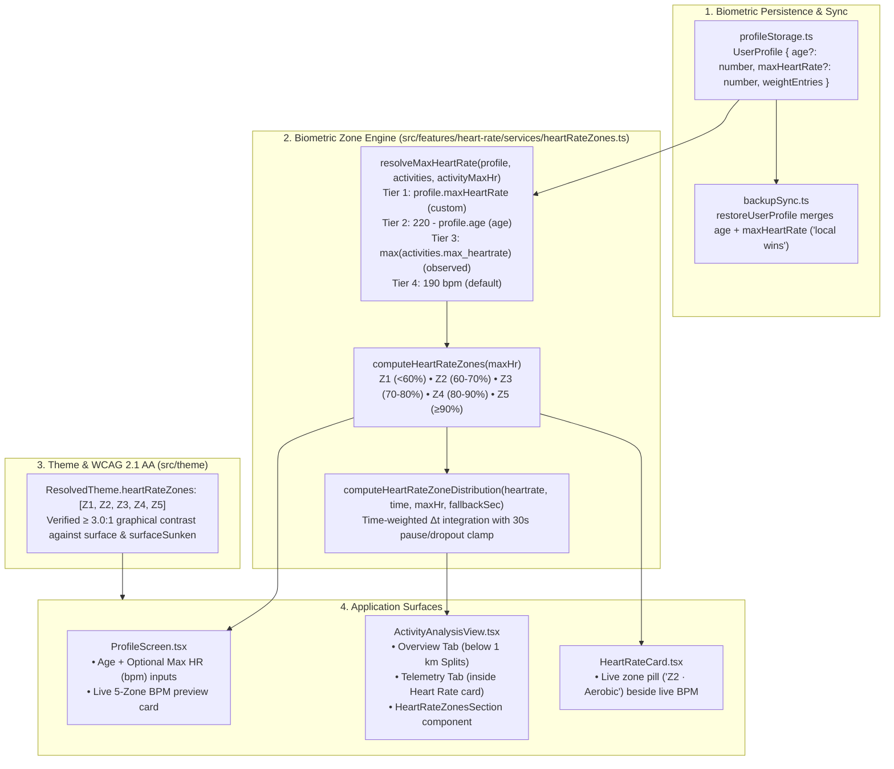

# 5-Zone Heart Rate System — Architecture, Ontology & Implementation Plan

This document specifies the end-to-end design for integrating a **5-Zone Heart Rate** system across **Offline Fitness**—spanning athlete biometric storage & WebDAV sync, the core zone calculation and time-weighted stream integration engine, WCAG 2.1 AA theme tokens, UI surfaces (`ProfileScreen`, `ActivityAnalysisView`, `HeartRateCard`), and formal ontology invariants in [docs/ontology.md](file:///Users/brunoorsier/dev/offline-fitness/docs/ontology.md).

---

## 1. Architectural Overview

---

## 2. Domain Model & Ontological Invariants (`docs/ontology.md`)

We will introduce two formal invariants in **§5.3 Biometrics: BLE Heart Rate Capture & Alignment** of [docs/ontology.md](file:///Users/brunoorsier/dev/offline-fitness/docs/ontology.md):

### `ONT-KIN-07` — Athlete Maximum Heart Rate ($\text{HR}_{\max}$) Resolution & 5-Zone Taxonomy
1. **Deterministic 4-Tier $\text{HR}_{\max}$ Resolution (`resolveMaxHeartRate`):**
   - **`'custom'`:** Explicit athlete override `profile.maxHeartRate` when integer $\in [100, 240]\text{ bpm}$.
   - **`'age'`:** Predicted via Fox formula $\text{HR}_{\max} = 220 - \text{profile.age}$ when `profile.age` $\in [1, 120]$ (clamped to $[100, 220]\text{ bpm}$).
   - **`'observed'`:** Highest historical `activity.max_heartrate` across `globalActivities` (or the current activity's `max_heartrate`) when $\ge 120\text{ bpm}$.
   - **`'default'`:** Canonical fallback `DEFAULT_MAX_HEART_RATE = 190` bpm when no profile or historical HR data exists.
2. **Half-Open 5-Zone Partitioning (`HEART_RATE_ZONE_DEFINITIONS`):**
   Given resolved integer $\text{HR}_{\max}$, zone thresholds are computed as $T_{p} = \lfloor p \times \text{HR}_{\max} \rfloor$:
   - **Zone 1 (`Z1` — Recovery):** $< T_{0.60}$ (nominal display band $\lfloor 0.50 \cdot \text{HR}_{\max} \rfloor\text{–}(T_{0.60} - 1)\text{ bpm}$; any valid active sample $> 0$ and $< T_{0.60}$ is bucketed into `Z1` so all active HR time is accounted for).
   - **Zone 2 (`Z2` — Aerobic):** $[T_{0.60}, T_{0.70} - 1]\text{ bpm}$ ($60\text{–}70\%$).
   - **Zone 3 (`Z3` — Tempo):** $[T_{0.70}, T_{0.80} - 1]\text{ bpm}$ ($70\text{–}80\%$).
   - **Zone 4 (`Z4` — Threshold):** $[T_{0.80}, T_{0.90} - 1]\text{ bpm}$ ($80\text{–}90\%$).
   - **Zone 5 (`Z5` — Anaerobic):** $\ge T_{0.90}\text{ bpm}$ ($90\text{–}100\%+$, unbounded above so supra-maximal efforts $> \text{HR}_{\max}$ are captured in `Z5`).

### `ONT-KIN-08` — Time-Weighted Heart-Rate Zone Integration (`computeHeartRateZoneDistribution`)
> [!IMPORTANT]
> **Why sample counting is forbidden:** Because [`compressStreamSet`](file:///Users/brunoorsier/dev/offline-fitness/src/features/activities/services/fetchAndStoreStreams.ts#L106-L157) applies Ramer-Douglas-Peucker (`simplify-js`) geometry simplification to `[lat, lon]` while keeping `time`, `altitude`, and `heartrate` index-aligned (`ONT-SPATIAL-01`), straight road segments have sparse samples separated by many seconds whereas winding segments have dense 1-second samples. Counting array elements biases zone distribution toward curvy terrain.

1. **Time-Series Integration (when `time.length === heartrate.length` and `time.length >= 2`):**
   - For each index $i \in [1, N - 1]$:
     - If `heartrate[i]` is `null` or $\le 0$, skip (sensor dropout / `HEART_RATE_NO_DATA` per `ONT-KIN-04` / `ONT-STORE-02`).
     - Compute $\Delta t = \text{time}[i] - \text{time}[i - 1]$.
     - If $\Delta t \le 0$, skip.
     - Clamp $\Delta t_{\text{eff}} = \min(\Delta t, \text{MAX\_HR\_SAMPLE\_GAP\_SECONDS})$ where `MAX_HR_SAMPLE_GAP_SECONDS = 30` so manual pauses or long GPS tunnels never credit minutes of stopped time to a single post-pause HR sample.
     - Add $\Delta t_{\text{eff}}$ to the zone bucket for `heartrate[i]`.
2. **Sample-Index Fallback (when `time` is absent or empty, per `ONT-KIN-04`):**
   - Collect all valid samples where `bpm !== null && bpm > 0`.
   - Each valid sample receives equal weight $\Delta t = \frac{\text{fallbackDurationSeconds}}{\text{validSampleCount}}$ (or `1` second if `fallbackDurationSeconds <= 0`).
3. **Distribution Output:**
   - Returns `zones: HeartRateZoneBucket[]` (each with `zone: 1..5`, `code: 'Z1'..'Z5'`, `name`, `minBpm`, `maxBpm`, `seconds`, `percentage: 0..100`), `totalTrackedSeconds`, `dominantZone`, and the `maxHrResolution` metadata (`maxHr`, `source`).

---

## 3. Step-by-Step Implementation Changes

### Step 1: Theme Layer & WCAG 2.1 AA Verification (`src/theme/`)
- **[types.ts](file:///Users/brunoorsier/dev/offline-fitness/src/theme/types.ts) & [resolve.ts](file:///Users/brunoorsier/dev/offline-fitness/src/theme/resolve.ts):**
  - Add `heartRateZones: [string, string, string, string, string]` to `NeutralTokens` and [`ResolvedTheme`](file:///Users/brunoorsier/dev/offline-fitness/src/theme/types.ts#L70-L132).
  - Select 5 distinct, intuitive physiological zone colors for both `light` and `dark` schemes that achieve $\ge 3.0:1$ contrast against both `theme.surface` (`#FFFFFF` light / `#171A21` dark) and `theme.surfaceSunken` (`#F3F4F6` light / `#22262F` dark):
    - **Light (`#FFFFFF` / `#F3F4F6`):**
      - `Z1` (Slate/Sky): `#0284C7` (contrast vs `#FFF`: `4.1:1`, vs `#F3F4F6`: `3.7:1`)
      - `Z2` (Emerald): `#15803D` (contrast vs `#FFF`: `5.0:1`, vs `#F3F4F6`: `4.5:1`)
      - `Z3` (Amber/Ochres): `#B45309` (contrast vs `#FFF`: `5.0:1`, vs `#F3F4F6`: `4.5:1`)
      - `Z4` (Deep Orange): `#C2410C` (contrast vs `#FFF`: `5.18:1`, vs `#F3F4F6`: `4.68:1`)
      - `Z5` (Crimson Red): `#B91C1C` (contrast vs `#FFF`: `6.47:1`, vs `#F3F4F6`: `5.85:1`)
    - **Dark (`#171A21` / `#22262F`):**
      - `Z1` (Sky): `#38BDF8` (contrast vs `#22262F`: `7.5:1`)
      - `Z2` (Green): `#4ADE80` (contrast vs `#22262F`: `9.4:1`)
      - `Z3` (Amber): `#FBBF24` (contrast vs `#22262F`: `9.9:1`)
      - `Z4` (Orange): `#FB923C` (contrast vs `#22262F`: `6.8:1`)
      - `Z5` (Rose/Red): `#F87171` (contrast vs `#22262F`: `5.8:1`)
- **[__tests__/theme/theme.spec.ts](file:///Users/brunoorsier/dev/offline-fitness/__tests__/theme/theme.spec.ts):**
  - Add an assertion verifying `theme.heartRateZones` has 5 hex colors and every zone color satisfies `contrast(color, theme.surface) >= 3` and `contrast(color, theme.surfaceSunken) >= 3` in both light and dark modes.

---

### Step 2: Athlete Profile Storage, reactive Hook & WebDAV Sync (`src/features/profile/` & `src/features/backup/`)
- **[profileStorage.ts](file:///Users/brunoorsier/dev/offline-fitness/src/features/profile/services/profileStorage.ts):**
  - Extend [`UserProfile`](file:///Users/brunoorsier/dev/offline-fitness/src/features/profile/services/profileStorage.ts#L11-L16) with `maxHeartRate?: number` (`100..240` bpm).
  - Sanitize `maxHeartRate` in [`loadUserProfile`](file:///Users/brunoorsier/dev/offline-fitness/src/features/profile/services/profileStorage.ts#L38-L61) (`typeof obj.maxHeartRate === 'number' && Number.isFinite(obj.maxHeartRate) && obj.maxHeartRate >= 100 && obj.maxHeartRate <= 240 ? Math.round(obj.maxHeartRate) : undefined`).
  - Add a lightweight listener mechanism (`subscribeUserProfile` / `useUserProfile` hook) so that when the user updates their `age` or `maxHeartRate` in `ProfileScreen`, any mounted consumer (`HeartRateCard`, `ActivityAnalysisView`) immediately reflects the updated zones without requiring an app restart.
- **[backupSync.ts](file:///Users/brunoorsier/dev/offline-fitness/src/features/backup/services/backupSync.ts):**
  - Update [`restoreUserProfile`](file:///Users/brunoorsier/dev/offline-fitness/src/features/backup/services/backupSync.ts#L586-L612) to preserve `maxHeartRate = localProfile?.maxHeartRate ?? remoteProfile?.maxHeartRate` alongside `age`.

---

### Step 3: Core Heart-Rate Zones Service & Reusable UI Component (`src/features/heart-rate/`)
- **Create `src/features/heart-rate/services/heartRateZones.ts`:**
  - `HEART_RATE_ZONE_DEFINITIONS`: metadata for `Z1`–`Z5` (`zone`, `code`, `name`, `minPct`, `maxPct`).
  - `resolveMaxHeartRate(options: { profile?: UserProfile | null; activities?: readonly Activity[]; activityMaxHr?: number | null }): MaxHeartRateResolution`
  - `computeHeartRateZones(maxHr: number): HeartRateZoneBoundary[]`
  - `getZoneForBpm(bpm: number, maxHr: number): HeartRateZoneBoundary | null`
  - `computeHeartRateZoneDistribution(params: { heartrate: readonly (number | null)[] | undefined; time?: readonly number[]; maxHrResolution: MaxHeartRateResolution; fallbackDurationSeconds?: number }): HeartRateZoneDistribution | null`
  - `formatZoneDuration(seconds: number): string`
- **Create `src/features/heart-rate/components/HeartRateZonesCard.tsx`:**
  - Reusable, theme-aware component that renders the 5-zone horizontal bar breakdown (`Z1`–`Z5` badge, zone name + BPM range, proportional bar in `theme.heartRateZones[i]` over `theme.surfaceSunken`, formatted time `MM:SS` / `H:MM:SS`, and percentage `XX%` using `theme.text` outside the bar to guarantee WCAG 2.1 AA contrast).
  - Includes a header subtitle showing the resolved Max HR and its provenance (`Max HR: 185 bpm (age)` / `(custom)` / `(observed)` / `(default)`).
- **Export from [src/features/heart-rate/index.ts](file:///Users/brunoorsier/dev/offline-fitness/src/features/heart-rate/index.ts).**

---

### Step 4: Integrate Across the 3 UI Surfaces
1. **[ProfileScreen.tsx](file:///Users/brunoorsier/dev/offline-fitness/src/features/profile/screens/ProfileScreen.tsx):**
   - Place **Age (years)** and **Max Heart Rate (bpm)** side by side (or stacked cleanly) with clear helper text (*"Leave Max HR blank to estimate from age (220 − age) or your highest recorded activity HR"*).
   - Render a **Heart-Rate Zones Preview** card showing the 5 zones (`Z1 Recovery` .. `Z5 Anaerobic`) and their exact BPM ranges for the user's current setting.
2. **[ActivityAnalysisView.tsx](file:///Users/brunoorsier/dev/offline-fitness/src/features/activities/components/ActivityAnalysisView.tsx) (Option A):**
   - Compute `hrZoneDistribution` using `useMemo` from `loadedStream?.streamSet.heartrate`, `loadedStream?.streamSet.time`, `userProfile`, `allActivities`, and `item`.
   - **Overview Tab (`OverviewSection`):** Render `HeartRateZonesCard` right below `SplitsSection` whenever `hrZoneDistribution` is non-null.
   - **Telemetry Tab (`TelemetryChartsSection`):** Render `HeartRateZonesCard` inside the **Heart Rate** chart card directly below `<HeartRateChart />`.
3. **[HeartRateCard.tsx](file:///Users/brunoorsier/dev/offline-fitness/src/features/heart-rate/components/HeartRateCard.tsx):**
   - In `ConnectedMetrics`, when `liveHr` is a valid number, resolve the active zone via `getZoneForBpm(liveHr, maxHr)` and render a tinted zone badge (`Z2 · Aerobic`) beside the live BPM value.

---

### Step 5: Ontology Update & Automated Verification Gates
- **[docs/ontology.md](file:///Users/brunoorsier/dev/offline-fitness/docs/ontology.md) & [AGENTS.md](file:///Users/brunoorsier/dev/offline-fitness/AGENTS.md):**
  - Add `ONT-KIN-07` and `ONT-KIN-08` to **§5.3 Biometrics: BLE Heart Rate Capture & Alignment** and update **§6.1 Local Storage Layout** (`userProfile`).
  - Re-index `codebase-memory-mcp` (`index_repository`) and verify coverage (`check_index_coverage`).
- **Unit Tests:**
  - `__tests__/heart-rate/heartRateZones.spec.ts`: test 4-tier Max HR resolution, 5-zone BPM boundaries, RDP irregular time-delta integration, 30s pause-gap clamping, `null` dropout handling, and sample-index fallback.
  - `__tests__/theme/theme.spec.ts`: verify WCAG contrast for `theme.heartRateZones`.
  - Update `__tests__/heart-rate/HeartRateCard.spec.tsx` if needed.
- **Definition of Done Gates:**
  - `npx tsc --noEmit`
  - `npx expo lint --fix`
  - `npm run check:imports && npm run check:mobile-only && npm run check:install-scripts`
  - `npm test -- --watchAll=false`
  - `scripts/sonar_gate.sh --scan` (0 open issues)
