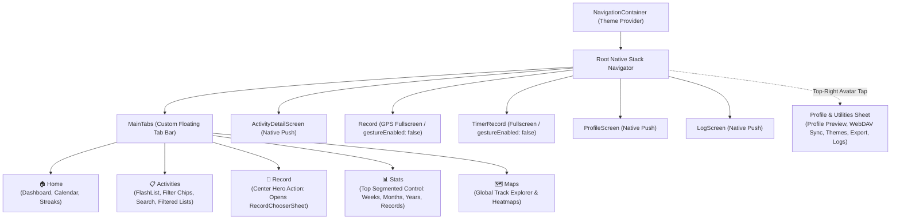

# Tier 3 Navigation Modernization: Gestural Floating Shell & Sheet-Driven Architecture

## 1. Executive Summary & Architectural Vision

This implementation plan outlines the transition of **Offline Fitness** from its legacy drawer-and-nested-tab navigation to a state-of-the-art, one-thumb mobile experience (**Tier 3**).

### The UX Shift

- **Before:** Primary navigation hidden behind a top-left drawer hamburger; 9 heterogeneous rows mixing screens, actions, modals, and debug tools; nested bottom tabs confined inside the `Stats` screen; activity detail displayed as an inline split-view resizing the list.
- **After:** A modern **Root Stack + Floating Capsule Tab Bar** with an elevated center Record action, a **Top Segmented Control** in Stats, dedicated **Native Stack drill-down** for Activity Details, and a **Universal Header & Profile/Settings Hub Sheet** replacing the drawer.

```
┌─────────────────────────────────────────────────────────────┐
│ 🏃 Offline Fitness                  [ Backup: OK | 👤 Hub ] │
├─────────────────────────────────────────────────────────────┤
│                                                             │
│                                                             │
│                       MAIN CONTENT AREA                     │
│               (Home / Activities / Stats / Maps)            │
│                                                             │
│                                                             │
│                                                             │
│                     ┌───────────────┐                       │
│                     │   🔴 RECORD   │                       │
│        ┌────────────┴───────────────┴────────────┐          │
│        │   🏠 Home   📋 Activities   📊 Stats   🗺️ Maps   │          │
│        └─────────────────────────────────────────┘          │
│                                                             │
└─────────────────────────────────────────────────────────────┘
```

---

## 2. Target Information Architecture (IA)

### 2.1 Navigation Graph Topology



### 2.2 Key Hierarchy Rules & Route Mapping

1. **Primary Navigation (5 Root Tabs):**
   - `Home`: Dashboard, Weekly Summary, Streaks, MiniMap, Calendar.
   - `Activities`: Activity list with search, filter chips, and sorting. Also supports incoming route params (`filterLabel`, `allActivities`, `selectedActivityId`) for filtered flows originating from Home calendar or Maps.
   - `Record` (Action Tab): Triggers the existing `openRecordChooser()` sheet. Does not switch to an empty tab screen; acts as a modal trigger.
   - `Stats`: Single screen hosting the 4 analytics views governed by a top segmented control. Accepts `segment?: 'weeks' | 'months' | 'years' | 'records'` to support shortcuts from Home.
   - `Maps`: Global activity map explorer (Android full implementation; iOS stub acknowledged).
2. **Detail Drill-Downs (Native Stack):**
   - `ActivityDetail`: Dedicated full-screen route pushed onto `RootStack` taking `{ activityId: string }` with native swipe-back on iOS and predictive back on Android. Uses `globalActivities` from `useActivitiesContext()` for similar-effort comparison.
3. **Recording Screens (Native Stack with Safety Interceptors):**
   - `Record` (GPS) and `TimerRecord` live as full-screen routes on `RootStack`.
   - Configured with `gestureEnabled: false` and a `beforeRemove` confirmation alert when a recording session is active to prevent accidental workout termination.
4. **System & Profile Management (Hub Sheet via `ProfileHubProvider`):**
   - Triggered via a header avatar button powered by `ProfileHubContext` (`openHub()`).
   - Houses: User Profile & Weight preview (with button to push `ProfileScreen`), WebDAV Cloud Backup status & "Sync Now", Palette Picker, Data Export (with progress overlay), and link to `LogScreen`.
   - _Note on theme toggling:_ Follows existing `ThemeProvider` (system scheme via `useColorScheme()`). Manual light/dark toggle is explicitly out of scope to avoid scope creep.
5. **Stats-Specific Settings:**
   - Stays dedicated to the `Stats` screen header via its existing gear button (keeps Goal expression editor, recent weeks/months sliders, and elapsed time toggle scoped to analytics).

---

## 3. Detailed Component Specifications

### 3.1 The Floating Island Tab Bar (`FloatingTabBar.tsx`)

- **Positioning & Geometry:**
  - Rendered as a custom `tabBar` component in `@react-navigation/bottom-tabs`.
  - Absolute positioning floating `12px` above `insets.bottom`.
  - Horizontal margins (`16px`), rounded corners (`28px` radius), border (`1px` solid `theme.border`), and surface elevation (`elevation: 8` on Android, soft shadow on iOS).
- **Styling & Theming:**
  - Uses `theme.surface` (with subtle border contrast) ensuring compliance with **WCAG 2.1 AA** across all 5 registered palettes (`legacy, twilight, alpine, terracotta, crimson`) in both light and dark modes (10 palette-scheme combinations).
  - Active icon/label: `theme.primary` with `700` font weight.
  - Inactive icon/label: `theme.textMuted` with `500` font weight.
- **Center Hero Action ("Record"):**
  - Sits at index 2 (center).
  - Circular elevated button with diameter `56px`, overflowing the tab bar top boundary by `14px`.
  - Background: `theme.primary` with `theme.onPrimary` icon.
  - Press animation: micro-scale bounce using Reanimated (`transform: [{ scale }]`).
  - Tapping interrupts standard navigation and calls `openRecordChooser()` directly via `ManualEntryContext`.
- **Scroll-Aware Auto-Hiding (`ScrollHideContext` & Reanimated Worklet):**
  - Shared Reanimated value `tabBarTranslateY` controlled via a lightweight `ScrollHideContext`.
  - When the user scrolls down quickly in `FlashList` (Activities) or `ScrollView` (Home), the bar translates down off-screen (`translateY: withTiming(100)`).
  - When scrolling stops or reverses upward, the bar translates back into view (`translateY: withTiming(0)`).
  - Respects accessibility preferences via `useReducedMotion()`.

### 3.2 Top Segmented Control for Stats (`StatsSegmentedControl.tsx`)

- **Elimination of Nested Tabs:**
  - Completely removes `createBottomTabNavigator` inside `StatsTab.tsx`.
- **Visual Structure:**
  - Horizontal pill container pinned directly below the screen header.
  - 4 Segments: `Last weeks` | `Last months` | `Last years` | `Records`.
  - Smooth animated sliding pill indicator (`Reanimated` shared value tracking segment index) with `theme.primary` active fill.
- **Route Params & Synchronization:**
  - Accepts optional initial segment from route params (`route.params?.segment`).
- **Performance:**
  - Renders only the active view or preserves view state using lazy mounting/hidden containers to avoid re-computing heavy chart aggregations.

### 3.3 Universal Header Builder & Profile Hub Sheet (`ProfileHubSheet.tsx`)

- **Native Header Integration:**
  - Uses React Navigation's native stack header rather than an overarching custom header component, preserving native title transitions, screen insets, and swipe-back affordance.
  - Shared `renderHeaderRight` helper provides the top-right avatar and backup health indicator.
- **Backup Health Indicator (`useBackupHealth` hook):**
  - Centralizes `STALE_BACKUP_MS = 14 * 24 * 60 * 60 * 1000` (currently local to `HomeScreen`).
  - Indicator badge dot on the avatar (green = healthy, amber = stale > 14 days, red = error).
- **`ProfileHubProvider`:**
  - Context holding `isHubOpen`, `openHub()`, and `closeHub()`.
  - Mounted at the app root inside `ManualEntryProvider` (satisfying `ONT-ARCH-05`).
- **Hub Sheet Contents (Modal / Bottom Sheet):**
  - Mounted at the app root directly above the navigators.
  - Modular cards:
    1. **Profile Card:** Shows age, latest logged weight, and button to open full `ProfileScreen` or import weight CSV.
    2. **Cloud Backup (WebDAV):** Shows status ("Last synced: X days ago"), "Sync Now" button, and server connection status.
    3. **Appearance:** Compact `PalettePicker` (selects from the 5 registered palettes).
    4. **Data Tools:** One-tap "Export Data (ZIP)" with existing `ProgressOverlay`.
    5. **Diagnostics:** App version, build number, and "View Logs" button (`LogScreen`).

### 3.4 Dedicated Activity Detail Screen (`ActivityDetailScreen.tsx`)

- **Decoupling from `DetailsScreen`:**
  - Wrap existing [`ActivityAnalysisView`](file:///Users/brunoorsier/dev/offline-fitness/src/features/activities/components/ActivityAnalysisView.tsx) into a thin screen component receiving `{ activityId: string }`.
  - Keeps cognitive complexity minimal (delegating render directly to `ActivityAnalysisView`).
  - `DetailsScreen` removes the split-view container, remaining a focused, performant list with search, filter chips, and multi-selection.
- **Screen Features:**
  - Native Stack Header: Back button (`< Activities`), Activity Title, and action menu (Edit name/notes, Delete, Share).
  - Full screen real estate for interactive map, 3D flyover launcher, elevation profile, and splits.

---

## 4. Architectural Invariants & Constraint Compliance

| Invariant / Constraint                             | Compliance Strategy                                                                                                                                                                                                                                                                                                       |
| :------------------------------------------------- | :------------------------------------------------------------------------------------------------------------------------------------------------------------------------------------------------------------------------------------------------------------------------------------------------------------------------ |
| **`ONT-ARCH-01` (Import Discipline)**              | Relative imports within `src/features/*`, barrel imports across features. Direct imports preserved for known cycles (`MiniMapComponent`, `RecordChooserSheet`, `RecordingScreen`, `trackComparison`). When `CustomDrawer` is retired, remove it from ontology exceptions and update `AGENTS.md` and `check-ontology.cjs`. |
| **`ONT-ARCH-02` (Portable Import Core)**           | All navigation type imports in `src/shared/types/types.ts` must use `import type` to prevent pulling React Navigation into the headless Node import core.                                                                                                                                                                 |
| **`ONT-ARCH-04` / `ONT-ARCH-05` (Sheet Mounting)** | All root sheets (`RecordChooserSheet`, `ProfileHubSheet`, `SettingsModal`) mounted directly under `AppContent` beside navigators in `ManualEntryProvider`, **never** inside tab panels or list item trees.                                                                                                                |
| **Mobile-Only (`check:mobile-only`)**              | No web imports (`react-native-web`, `react-dom`). Native animations via `react-native-reanimated` worklets.                                                                                                                                                                                                               |
| **React Compiler & Immutability**                  | Pure components, no `try/finally` inside compiled components, `createStyles(theme)` memoized on theme. No `useState` + `useEffect` synchronization.                                                                                                                                                                       |
| **WCAG 2.1 AA Contrast**                           | Normal text $\ge 4.5:1$, graphical UI/icons $\ge 3.0:1$ across all 5 registered palettes in both light and dark modes. Floating tab bar uses `theme.surface` with `theme.border` for clear delineation against background content.                                                                                        |
| **SonarCloud Quality Gate**                        | Zero `OPEN` or `CONFIRMED` issues. All new components must adhere to strict typing, no cognitive complexity spikes, and no floating promises.                                                                                                                                                                             |

---

## 5. Phased Implementation Roadmap

### Phase 0: Prerequisites & Package Setup

- **Goal:** Install required navigation packages, define types, and set up the hub context while keeping the drawer intact.
- **Tasks:**
  1. **Install Package:** `npm install @react-navigation/native-stack@^7.2.0` (matching `@react-navigation/bottom-tabs` v7).
  2. **Install Haptics (Optional/Guarded):** Install `expo-haptics` with defensive wrapper fallback.
  3. **Define Navigation Types (`RootStackParamList`, `MainTabParamList`):**
     - Define `RootStackParamList`: `Main`, `ActivityDetail: { activityId: string }`, `Record: undefined`, `TimerRecord: undefined`, `Profile: undefined`, `Logs: undefined`.
     - Define `MainTabParamList`: `Home: undefined`, `Activities: { allActivities?: Activity[]; filterLabel?: string; selectedActivityId?: string } | undefined`, `RecordAction: undefined`, `Stats: { segment?: 'weeks' | 'months' | 'years' | 'records' } | undefined`, `Maps: undefined`.
     - Maintain `import type` in `src/shared/types/types.ts` for ONT-ARCH-02.
  4. **Create `ProfileHubContext`:** Create `ProfileHubContext.tsx` with `useProfileHub()` hook.
  5. **Create `useBackupHealth`:** Centralize the 14-day stale backup computation for reuse across Home and Header.

### Phase 1: Screen Decoupling & Segmented Stats (Non-Breaking)

- **Goal:** Remove nested tabs in Stats and decouple split-screen activity analysis.
- **Tasks:**
  1. **Refactor `StatsTab`:** Replace `createBottomTabNavigator` with `StatsSegmentedControl`. Support `route.params?.segment`.
  2. **Create `ActivityDetailScreen`:** Wrap `ActivityAnalysisView` into a dedicated screen component.
  3. **Verification:** Run tests (`npm test`), lint (`npm run lint`), and verify zero new Sonar issues.

### Phase 2: Hub Sheet & Header Action

- **Goal:** Build the single destination for Profile, Backup, Theme, Export, and Logs so the drawer can be safely retired.
- **Tasks:**
  1. **Create `ProfileHubSheet.tsx`:** Aggregate user profile preview, WebDAV status/sync, palette selector, export trigger, and logs button into a sheet.
  2. **Mount in Root:** Mount `ProfileHubSheet` in `App.tsx` inside `ProfileHubProvider`.
  3. **Wire Header Avatar:** Connect the avatar trigger to `openHub()`.

### Phase 3: Root Navigator Transition (Bottom Tabs + Native Stack)

- **Goal:** Replace `createDrawerNavigator` with `@react-navigation/native-stack` + `@react-navigation/bottom-tabs`.
- **Tasks:**
  1. **Build `FloatingTabBar.tsx`:** Create the capsule tab bar with 5 items (Home, Activities, Record action button, Stats, Maps).
  2. **Build `MainTabNavigator.tsx`:** Configure the bottom tabs using `FloatingTabBar`.
  3. **Build `RootStackNavigator.tsx`:**
     - `Main`: Hosts `MainTabNavigator`.
     - `ActivityDetail`: Dedicated stack push from Activities list.
     - `Record`: Full-screen live GPS recording with `gestureEnabled: false`.
     - `TimerRecord`: Full-screen live timer recording with `gestureEnabled: false`.
     - `Profile`: Full profile & weight history view.
     - `Logs`: Full debug log viewer.
  4. **Bulk Navigation Prop Type Migration:** Use disciplined codemod/occurrence-counted update across ~15 screens/components from `DrawerNavigationProp` to `NativeStackNavigationProp` / `BottomTabNavigationProp`.
  5. **Update `App.tsx`:** Swap `Drawer.Navigator` for `RootStackNavigator`.
  6. **Retire Drawer & Update Ontology:**
     - Remove `CustomDrawer.tsx` and its test.
     - Update `docs/ontology.md` §7.1 (remove `CustomDrawer` cycle exception with permission).
     - Update `AGENTS.md`, `docs/architecture.md`, and `scripts/check-ontology.cjs`.

### Phase 4: Gestural & Polish Pass

- **Goal:** Add fluid scroll-aware animations, safe areas, and bottom padding.
- **Tasks:**
  1. **Scroll-Aware Worklet:** Connect `ScrollHideContext` to `HomeScreen` and `DetailsScreen` (FlashList `onScroll`) to smoothly hide/show the floating capsule tab bar on scroll (gated by `useReducedMotion()`).
  2. **List Padding Insets:** Apply consistent bottom padding (`80px + insets.bottom`) across all scroll views and FlashLists.
  3. **Haptic Feedback:** Add micro-vibrations on tab selection and center record button press.

### Phase 5: Verification & Quality Gate

- **Goal:** Complete Definition of Done.
- **Tasks:**
  1. `npx tsc --noEmit` (0 errors).
  2. `npx expo lint --fix` (0 errors).
  3. `npm run check:all` (imports, ontology, mobile-only, circular deps, doctor, format).
  4. `npm test -- --watchAll=false` (all unit and component tests passing).
  5. Update `docs/status.md` and `docs/architecture.md`.
  6. `scripts/sonar_gate.sh --scan` (Hard requirement: 0 open Sonar issues).

---

## 6. Risk Analysis & Mitigations

| Risk                                                          | Impact   | Mitigation Strategy                                                                                                        |
| :------------------------------------------------------------ | :------- | :------------------------------------------------------------------------------------------------------------------------- |
| **Content hidden behind Floating Tab Bar**                    | High     | Apply uniform bottom content insets (`80px + insets.bottom`) across all scroll views and lists.                            |
| **Accidental Navigation during Live GPS Recording**           | Critical | Set `gestureEnabled: false` on `Record` and `TimerRecord` routes, with `beforeRemove` alert when tracking.                 |
| **`check-ontology.cjs` Failure upon deleting `CustomDrawer`** | High     | Synchronously update `docs/ontology.md`, `AGENTS.md`, `docs/architecture.md`, and `scripts/check-ontology.cjs` in Phase 3. |
| **Type Migration Regressions across ~15 files**               | Medium   | Execute occurrence-counted replacement with strict `tsc --noEmit` validation immediately after.                            |
| **Filtered Activities Flow Breakdown**                        | Medium   | Maintain `allActivities` and `filterLabel` optional params in `Activities` tab route schema.                               |
| **Sonar Cognitive Complexity in Activity Detail**             | Low      | Keep `ActivityDetailScreen` thin; delegate layout and logic directly to `ActivityAnalysisView`.                            |
