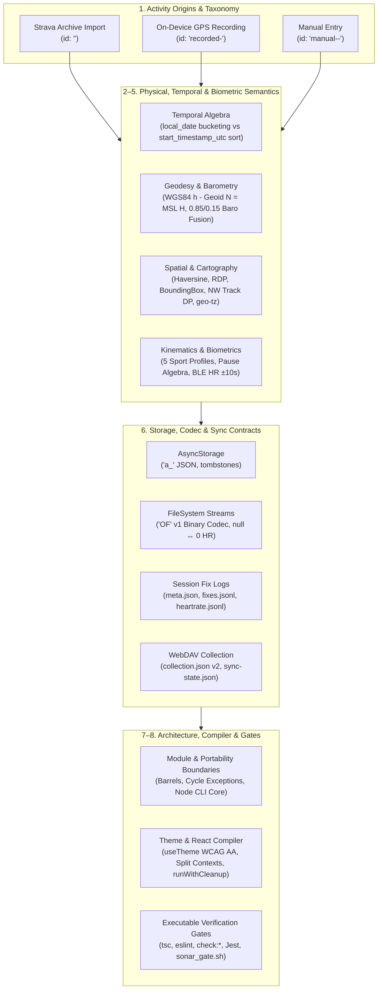
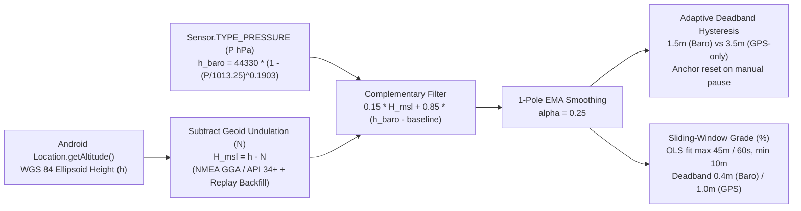

# Offline Fitness — Codebase & Domain Ontology

This document defines the **formal domain, geophysical, spatial, kinematic, behavioral, and governance ontology** of the `offline-fitness` codebase.

While static AST and call-graph indexers (such as `codebase-memory-mcp`) capture **syntactic structure** (`File`, `Function`, `Class`, `Interface`, `CALLS`, `IMPORTS`), this ontology captures the **semantic world model**: physical units, vertical datums, coordinate projections, temporal algebra, state machines, cross-boundary contracts, retired ("negative-space") concepts, and machine-checkable invariants.

---

## Ontology Overview Diagram



---

## 1. Core Domain Entities & Activity Origin Taxonomy

### 1.1 The Three Activity Origins
Every workout in the system converges into the canonical `Activity` interface (`src/shared/types/types.ts`), persisted in `AsyncStorage` under key `a_<id>` (`STORAGE_KEYS.ACTIVITY_PREFIX` in `src/constants/index.ts`). However, activities originate from **three distinct pipelines** with strict identity and timezone rules:

| Origin | ID Pattern | Builder / Mapper | Timezone Source of Truth | Stream / Track Presence |
| --- | --- | --- | --- | --- |
| **Archive-Imported** | `<numericId>` (e.g. `"1234567890"`) | `rowToActivity` in `src/features/strava-import/services/activityMapper.ts` | IANA zone of the GPS track start coordinate via `createGeoZoneLookup` (`scripts/strava-import-tool/zoneLookup.ts`), falling back to CLI `--tz`. **Never** the desktop machine's ambient timezone. | Optional (`streams/<id>.json` in `'OF'` v1 binary format if `.gpx` track existed in export). |
| **On-Device Recorded** | `recorded-<startUtcMs>-<counter>` (counter = trailing segment of the session id) | `buildRecordedActivity` in `src/features/recording/services/buildRecordedActivity.ts` | Device IANA timezone at recording save time (`deviceTimezoneLabel()`). | Present if accepted GPS fixes $> 0$; written via `writeStreamFile` (`src/features/recording/services/writeStreamFile.ts`) before `addActivity`. |
| **Manually Entered** | `manual-<startUtcMs>-<base36Counter>` | `buildManualActivity` in `src/features/activities/services/manualActivity.ts` | Device local timezone evaluated **at the entered historical date/time** (`wallClock.getTimezoneOffset()`), preserving historical DST. | Always empty (`start_latlng: []`, `end_latlng: []`), even when retroactive `distanceKm` or `elevationGainM` is supplied. |

### 1.2 Activity Type Taxonomy & Categorization Rules

* **`ONT-DOM-01` — GPS-less Activity Types (`NO_GPS_ACTIVITY_TYPES`):**
  Defined in `src/shared/utils/activityCategories.ts` (`isNoGpsActivity`):
  `Yoga`, `Workout`, `WeightTraining`, `Pilates`, `Crossfit`, `PhysicalTherapy`, `Elliptical`, `StairStepper`.
  * **Exclusion Rule:** Excluded from map views (`MapsScreen`, `MiniMapComponent`), stream lookups, and location-based statistics (distance and elevation tables).
  * **Inclusion Rule:** Included in all time-based statistics (hours tables, calendar activity dots, day/week streaks, and `GoalService` weekly goals).
* **`ONT-DOM-02` — Derived Streamless Set (`getNoStreamIds`):**
  Defined in `src/features/activities/services/fetchAndStoreStreams.ts`. Legacy `.nostreamflag` files are retired. An activity is permanently streamless if and only if `activity.start_latlng` has fewer than 2 coordinates **and** no `<id>.json` or `<id>.bin` file exists in `APP_CONFIG.STREAMS_FOLDER`.
* **`ONT-DOM-03` — Sibling Sport Type Folding (`mergeActivities`):**
  Defined in `src/features/activities/services/mergeActivities.ts` (`MERGED_ACTIVITY_TYPES`), controlled by `mergeSimilarActivities` in `src/features/stats/StatsTabSettingsContext.tsx`:
  * `EBikeRide` $\to$ `Ride`
  * `Hike` $\to$ `Walk`
  * `Workout` $\to$ `Yoga` *(Strava exported Yoga activities as `'Workout'` starting 2025-08-20; folding unifies historical and recent Yoga sessions).*
  * **Co-Folding Invariant:** Both the `activities` array and the discovered type header list (`myActivitiesMerged`) **must** be transformed together. Folding one without the other leaves stats table columns uninitialized and produces `NaN` totals.
* **`ONT-DOM-04` — Manual Type Ordering (`buildManualTypeList`):**
  Defined in `src/features/activities/services/manualActivity.ts`. Orders selectable types by: (1) `STORAGE_KEYS.MANUAL_LAST_TYPE`, (2) user's existing activities sorted by descending frequency then alphabetical, (3) `STORAGE_KEYS.MANUAL_CUSTOM_TYPES`, (4) `MANUAL_ACTIVITY_TYPES` defaults, with case-insensitive deduplication where first-seen casing wins.
* **`ONT-DOM-05` — Swim Canonicalization at Write Time:**
  Enforced in `applySwimMovingTime` / `correctSwimElevationGain` (`src/features/strava-import/services/activityMapper.ts`), `buildRecordedActivity` (`src/features/recording/services/buildRecordedActivity.ts`), `replaySession` (`src/features/recording/services/replaySession.ts`), and `buildManualActivity` (`src/features/activities/services/manualActivity.ts`):
  * For any `Swim` / `swimming` activity: `moving_time = elapsed_time` and `total_elevation_gain = 0` (and `elevationLossMeters = 0`, `slope = 0`).
  * **Rationale:** Open-water GPS vertical noise and slow turn/rest laps corrupt moving time and elevation gain; canonicalizing at write time guarantees byte-identical records across desktop seeding, phone recording, and WebDAV MD5 hashing.

---

## 2. Temporal & Calendar Algebra

All date/time operations are governed by `src/shared/utils/activityDates.ts` and `src/shared/utils/isoWeek.ts`.

### 2.1 The "Mislabeled-`Z`" Prohibition
* **`ONT-TIME-01` — Never Parse `start_date_local` with `new Date()`:**
  Following Strava's convention, `activity.start_date_local` stores **athlete-local wall-clock time** suffixed with a literal `Z` (e.g., `"2023-02-25T16:14:44Z"`).
  * Calling `new Date(activity.start_date_local)` interprets wall time as UTC (off by `utc_offset`) and `Date.prototype.get*()` / `.toLocale*()` shifts it a second time by the phone's current timezone.
  * Evening activities in another timezone will silently jump to the wrong calendar day or ISO week if `new Date()` is used.

### 2.2 Three-Way Separation of Temporal Concerns

| Operation | Canonical Field / Helper | Representation | Rule |
| --- | --- | --- | --- |
| **Chronological Sorting & Recency** | `activity.start_timestamp_utc` via `activityUtcMs`, `compareActivitiesByUtcDesc`, `compareActivitiesByUtcAsc` | UTC epoch milliseconds (`number`) | `globalActivities` in `useActivities` is always maintained in descending `start_timestamp_utc` order. |
| **Calendar Bucketing (Day / Month / Year / YTD)** | `activity.local_date` (`YYYY-MM-DD`), `start_year`, `start_month` (`0..11`, **0-indexed**), `start_day`, `activityDayOfYear` | Athlete-local strings / integers | Never instantiate `Date` to extract year, month, or day of an activity. |
| **Wall-Clock Display** | `activityLocalDate`, `activityLocalTime`, `formatActivityLocalDateTime` | `"YYYY-MM-DD"` and `"HH:MM:SS"` | Display the pre-computed local strings directly. |
| **DST-Safe Day Consecutiveness** | `localDateToDayNumber(localDate)` | Integer days since Unix epoch ($\lfloor\text{Date.UTC}(y, m-1, d) / 86400000\rfloor$) | Used in `computeDayStreaks` (`src/shared/services/streaks.ts`) so 23-hour and 25-hour DST transition days never break integer day diffs. |

### 2.3 ISO-8601 Week Algebra (`src/shared/utils/isoWeek.ts`)
* **`ONT-TIME-02` — Thursday-Based ISO Year & Week (`YYYY-Www`):**
  * Weeks run Monday through Sunday. Week 1 of an ISO year is the week containing the year's first Thursday (equivalently, containing January 4, or where `week_of_year(isoYear, 11, 28)` determines whether the ISO year has 52 or 53 weeks).
  * **Year-Boundary Crossing:** A December 29–31 activity falling in `W01` belongs to `isoYear = start_year + 1`; a January 1–3 activity falling in `W52`/`W53` belongs to `isoYear = start_year - 1`.
  * **Canonical Key Helper:** Always use `activityIsoWeekKey(activity)` (which parses `activity.local_date` via `isoWeekKeyFromLocalParts`), never raw `start_year` + `start_week` concatenation.
  * **Contiguity:** `isContiguousIsoWeek(prevKey, nextKey)` handles both intra-year (`week + 1`) and cross-year (`W52/W53` $\to$ `nextYear-W01`) adjacency.

---

## 3. Geophysical, Geodetic & Barometric Ontology

The physical elevation and terrain grade pipeline spans `modules/gps-tracker/android/src/main/java/com/gpslib/tracker/altitude/AltitudeProcessor.kt`, `src/features/recording/services/replaySession.ts`, `src/features/recording/services/slope.ts`, and `src/features/activities/components/ActivityAnalysisView.tsx` (documented in `docs/altitude-recording-improvements.md`).



### 3.1 Vertical Datums: WGS 84 Ellipsoid ($h$) vs. Geoid ($N$) vs. Orthometric MSL ($H$)
* **`ONT-GEO-01` — Orthometric Height Conversion ($H = h - N$):**
  * Android's `Location.getAltitude()` (`FixLogEntry.ele` / `rawAltitudeMeters`) reports height $h$ above the **WGS 84 reference ellipsoid**, not Mean Sea Level (MSL).
  * Human-facing elevation and topographic maps use **orthometric height** $H$ above the geoid (MSL):
    $$H_{\text{MSL}} = h_{\text{WGS84}} - N_{\text{geoid}}$$
  * In Western Europe, $N \approx +45\text{ m to }+50\text{ m}$.
* **`ONT-GEO-02` — Asynchronous NMEA `GGA` Geoid Delivery & Replay Backfill:**
  * On Android < 14, geoid undulation $N$ (`geoidHeightMeters` / `FixLogEntry.geoid`) is parsed from NMEA `$GPGGA` / `$GNGGA` sentences in `AltitudeProcessor.kt`, which arrive 1–5 seconds *after* the first GPS location fix. (On Android 14 / API 34+, `Location.getMslAltitudeMeters()` derives $N = h - H_{\text{MSL}}$ on fix 0).
  * **Mandatory Replay Backfill (`resolveMslAltitude` in `replaySession.ts`):** Early fixes where `fix.geoid == null` **must** inherit `firstKnownGeoid` (pre-scanned across the session: `fixes.find(f => f.geoid != null)?.geoid`). Without backfill, fix 0 uses raw ellipsoid height $h$ and drops ~48 m as soon as NMEA arrives, corrupting the altitude chart, elevation loss, and barometric baseline calibration.

### 3.2 Atmospheric Physics & Complementary Sensor Fusion
* **`ONT-GEO-03` — International Barometric Formula (`barometricAltitude`):**
  Converts atmospheric pressure $P$ (in hectopascals, `hPa`, from `Sensor.TYPE_PRESSURE`) to pressure altitude in meters:
  $$h_{\text{baro}}(P) = 44330 \times \left(1 - \left(\frac{P}{1013.25}\right)^{0.1903}\right)$$
* **`ONT-GEO-04` — Barometer / GPS Complementary Filter (`fuseBarometer`):**
  * On the first fix with both valid MSL altitude and pressure, `baselineBaro = baroAlt - msl`.
  * On subsequent fixes, barometric relative altitude (`baroDerived = baroAlt - baselineBaro`) is fused with GPS MSL altitude using:
    $$\text{estimated} = 0.15 \cdot H_{\text{MSL}} + 0.85 \cdot h_{\text{baro\_derived}}$$
    (`BARO_WEIGHT_GPS = 0.15`, `BARO_WEIGHT_BARO = 0.85`).
  * **Physical Rationale:** Hardware barometers have sub-meter relative precision ($\pm 0.1\text{–}0.3\text{ m}$) and must dominate short-term vertical changes, while GPS MSL ($\pm 5\text{–}15\text{ m}$ vertical noise) provides only slow baseline correction against weather pressure drift.
* **`ONT-GEO-05` — Exponential Moving Average Smoothing (`SMOOTHING_ALPHA = 0.25`):**
  Applied to every accepted fix's estimated altitude in both `replaySession.ts` and `LiveSlopeCalculator` (`src/features/recording/services/slope.ts`):
  $$s_t = 0.25 \cdot \text{estimated}_t + 0.75 \cdot s_{t-1}$$

### 3.3 Adaptive Deadband Hysteresis & Terrain Grade (Slope)
* **`ONT-GEO-06` — Sensor-Adaptive Elevation Hysteresis (`applyHysteresis`):**
  Cumulative elevation gain (`D+`) and loss (`D-`) are only accrued when smoothed altitude moves away from `anchor` by at least a sensor-specific deadband threshold:
  * **With barometric pressure (`fix.pressure != null`):** `HYSTERESIS_THRESHOLD_BARO_M = 1.5` m.
  * **GPS-only (`fix.pressure == null`):** `HYSTERESIS_THRESHOLD_GPS_M = 3.5` m (absorbs $\pm 2\text{–}3\text{ m}$ GPS vertical multipath random walk on flat terrain).
  * **Manual Pause Anchor Reset:** When crossing a manual pause boundary (`handleManualPauseBoundary` in `replaySession.ts` and `LiveSlopeCalculator.onPause` in `slope.ts`), `anchor` **must** be reset to `null` so elevation changes while paused (e.g., riding a ski lift or driving) are not counted as climb or descent.
  * **Chart Display Hysteresis:** `ActivityAnalysisView.tsx` applies a `1.5 m` deadband when computing the cumulative elevation gain series for charts, and forces all points to `0` when `activity.total_elevation_gain === 0`.
* **`ONT-GEO-07` — Sliding-Window Terrain Slope (`updateSlopeWindow` and `LiveSlopeCalculator` in `slope.ts`):**
  * Maintains a FIFO buffer of `{ t, distance, altitude }` samples pruned when $\Delta\text{distance} > 45\text{ m}$ (`SLOPE_WINDOW_METERS`) or $\Delta t > 60,000\text{ ms}$ (`SLOPE_WINDOW_MS`), preserving at least `SLOPE_MIN_DISTANCE_M` baseline.
  * In `TrackingService.kt`, suppresses stationary GPS drift steps (`location.speed < threshold && stepMeters < max(accuracy, 3)`), keeping distance at 0 when the device is not moving.
  * In `LiveSlopeCalculator`, detects stationary state (`speed < stationarySpeedThreshold`). While stationary, no samples are pushed and slope clears to `null` (`—`) when stationary or after `STATIONARY_HOLD_MS = 5,000` ms, preventing phantom grades while standing still or sitting at a desk.
  * In `LiveSlopeCalculator`, fuses live barometric pressure via `fuseBarometer` (`0.85 * baro + 0.15 * gps`) when available from `LocationUpdate.pressureHpa`.
  * Computes slope via Ordinary Least Squares (OLS) linear regression across all samples in the window, then applies a sensor-adaptive vertical deadband (soft-thresholding):
    * **With barometric pressure:** `SLOPE_DEADBAND_BARO_M = 0.4` m.
    * **GPS-only:** `SLOPE_DEADBAND_GPS_M = 1.0` m (suppresses $\pm 2\text{ m}$ flat-ground GPS vertical wander down to $\sim 0.0\%\pm 0.5\%$).
  * Emits grade percentage $\frac{\Delta\text{altitude}_{\text{effective}}}{\max(\Delta\text{distance}, \text{SLOPE_WINDOW_METERS} / 2)} \times 100$ only when $\Delta\text{distance} \ge 10\text{ m}$ (`SLOPE_MIN_DISTANCE_M`), holding the previous slope otherwise to avoid division-by-small-distance spikes.

---

## 4. Spatial, Cartographic & Geopolitical Ontology

### 4.1 Coordinate Representations & Quantization
Agents must never confuse the four coordinate shapes used across the codebase:

| Layer / Module | Type / Property | Coordinate Order & Shape | Precision / Scale |
| --- | --- | --- | --- |
| **Raw Fix Log (`fixes.jsonl`)** | `FixLogEntry` (`src/features/recording/services/gpsTracker.ts`) | `{ lat: number, lon: number }` (WGS 84 degrees) | Full IEEE-754 `double` from Android `Location` |
| **Canonical Stream (`StreamSet`)** | `LatLngStreamSet.data` (`src/features/activities/types/stravaActivityStream.model.ts`) | `[latitude, longitude][]` (2-element tuple array) | Rounded to `1e-6` deg ($\approx 0.11\text{ m}$) via `roundCoordinate`; altitude rounded to `0.1` m via `roundElevation` |
| **Binary Stream Codec (`'OF'` v1)** | `encodeStreamSet` / `decodeStreamSet` (`src/shared/services/streamCodec.ts`) | Separate little-endian `Int32Array` blocks (`lat * 1e6`, `lon * 1e6`, `alt * 10`) | `COORD_SCALE = 1_000_000`, `ALTITUDE_SCALE = 10` |
| **UI, Maps & Track Comparison** | `LatLng` (`src/shared/types/types.ts`) | `{ latitude: number, longitude: number }` | Converted from `StreamSet` in `fetchAndStoreStreams.ts` |
| **Ramer-Douglas-Peucker (`simplify-js`)** | `compressStreamSet` (`src/features/activities/services/fetchAndStoreStreams.ts`) | `{ x: longitude, y: latitude }` | Mapped temporarily for `simplify(points, tolerance, highestQuality)` while preserving index alignment across `altitude`, `time`, and `heartrate` |

### 4.2 Geodesic Distance, Bearing & 3D Flyover Kinematics
Implemented in `src/features/maps/services/flyoverInterpolator.ts`, `src/features/recording/services/replaySession.ts`, and `src/shared/services/trackComparison.ts`:
* **`ONT-SPATIAL-01` — Orthodromic Distance (`haversineDistance` / `haversineMeters`):**
  Great-circle distance on a spherical Earth of radius $R = 6,371,000\text{ m}$.
* **`ONT-SPATIAL-02` — Azimuth & Circular Angle Algebra (`flyoverInterpolator.ts`):**
  * `calculateBearing(p1, p2)`: Forward initial azimuth in $[0^\circ, 360^\circ)$ clockwise from true North.
  * `shortestAngularDifference(from, to)`: Signed delta in $[-180^\circ, 180^\circ)$ via `((to - from + 540) % 360) - 180`.
  * `circularMean(bearings)`: Smooths camera headings over a sliding window (`DEFAULT_SMOOTHING_WINDOW = 5`) using unit-vector summation $\text{atan2}(\sum \sin\theta, \sum \cos\theta)$ so headings oscillating across North ($359^\circ \leftrightarrow 1^\circ$) average to $0^\circ$, never $180^\circ$.
  * Camera defaults: `DEFAULT_PITCH_DEGREES = 60`, `DEFAULT_MIN_MOVEMENT_METERS = 1.5` (holds previous bearing below 1.5 m movement).

### 4.3 Spatial Indexing & Global Track Alignment
* **`ONT-SPATIAL-03` — Axis-Aligned Bounding Boxes (`calculateBoundingBox`):**
  Defined in `src/shared/utils/utils.ts` and `trackBoundingBox` in `src/features/strava-import/services/gpxParser.ts`.
  * Stored on `Activity.bounding_box` as `[[minLat, minLng], [maxLat, maxLng]]` (two coordinate pairs).
  * Used by `MapsScreen` viewport filtering and `backfillBoundingBox` (`src/features/activities/services/fetchAndStoreStreams.ts`).
* **`ONT-SPATIAL-04` — Needleman-Wunsch Track Similarity (`compareTracks` in `src/shared/services/trackComparison.ts`):**
  * Compares two `LatLng[]` tracks via dynamic programming global sequence alignment:
    * Point match similarity kernel: $s(p_1, p_2) = \frac{a}{a + d_{\text{haversine}}(p_1, p_2)}$ with smoothing constant $a = 10\text{ m}$ (score in $(0, 1]$).
    * Insertion/deletion `gapPenalty = -0.5`.
  * **Normalization Invariant:** Because global alignment of tracks of unequal lengths $n \ne m$ incurs at least $|n - m| \times \text{gapPenalty}$, the maximum theoretical score is $\min(n, m) \cdot 1.0 + |n - m| \cdot (-0.5)$, **not** $\min(n, m)$. The normalized score is clamped to $[0, 1]$.

### 4.4 Geopolitical Timezone Resolution (`zoneLookup.ts`)
* **`ONT-SPATIAL-05` — Coordinate-to-IANA Timezone (`createGeoZoneLookup`):**
  In `scripts/strava-import-tool/zoneLookup.ts` and `scripts/strava-import-tool/timezone.ts`:
  * Resolves the IANA timezone (e.g., `"Europe/Paris"`) from the first valid `[lat, lon]` point of an activity's GPX stream using `geo-tz`, falling back to the required `--tz` CLI flag only when an activity has no GPS fixes.
  * `utcToLocalParts(utcMs, zone)` (`src/features/strava-import/services/activityMapper.ts`) uses `Intl.DateTimeFormat(..., { timeZone: zone }).formatToParts` so the host computer's local timezone never leaks into imported records.

---

## 5. Kinematic, Biometric & Recording Session Ontology

### 5.1 Sport Profiles & Physical Filter Envelopes (`src/features/recording/services/profiles.ts`)
The 5 recording profiles (`PROFILES`: `'walking' | 'running' | 'hiking' | 'cycling' | 'swimming'`, persisted under `STORAGE_KEYS.RECORDING_LAST_PROFILE`, defaulting to `'running'`) govern both native capture (`PROFILE_CAPTURE_OPTIONS`) and TypeScript replay filtering (`PROFILE_FILTER_OPTIONS`):

| Profile | `intervalMs` / `minIntervalMs` | `minDistanceM` | `accuracyCeilingM` / `maxAccuracyMeters` | `maxSpeedMps` | `stationarySpeedThreshold` | `driftSuppressionEnabled` | `useBarometer` | Default Rate Unit |
| --- | --- | --- | --- | --- | --- | --- | --- | --- |
| **`walking`** | `2000` ms | `2.5` m | `15` m | `5` m/s (18 km/h) | `0.4` m/s | `true` | `true` | Pace (`min/km`) |
| **`running`** | `1000` ms | `2.0` m | `15` m | `12` m/s (43.2 km/h) | `0.5` m/s | `true` | `true` | Pace (`min/km`) |
| **`hiking`** | `4000` ms | `4.0` m | `20` m | `7` m/s (25.2 km/h) | `0.3` m/s | `true` | `true` | Pace (`min/km`) |
| **`cycling`** | `1000` ms | `3.0` m | `15` m | `35` m/s (126 km/h) | `0.8` m/s | `true` | `true` | Speed (`km/h`) |
| **`swimming`** | `1000` ms | `0.5` m | `25` m | `3.5` m/s (12.6 km/h) | `0.5` m/s | `false` | `false` | Pace (`min/100m`) |

### 5.2 Canonical Fix-Rejection Order & Pause Algebra (`src/features/recording/services/replaySession.ts`)
* **`ONT-KIN-01` — Two-Stage Filter Ordering Around Auto-Pause (`processFix`):**
  1. **Pre-Auto-Pause Filters (`preAutoPauseFilterReason`):** Rejects corrupt fixes *before* updating auto-pause state or `lastAccepted`:
     * `'accuracy'` (`fix.hAcc > maxAccuracyMeters`)
     * `'stale-timestamp'` (`fix.t <= lastAccepted.t`)
     * `'interval-too-short'` (`deltaMs < minIntervalMs`, skipped if crossing a manual pause)
     * `'speed-jump'` (`dist / deltaSec > maxSpeedMps`, skipped if crossing a manual pause)
  2. **Manual Pause Boundary Rule:** If a manual pause occurred between `lastAccepted.t` and `fix.t`, `stepDistance` is forced to `0` (straight-line distance across a pause is **never** accumulated), the current moving segment is closed, any active auto-pause is capped at `pauseStart`, and the altitude hysteresis `anchor` is reset.
  3. **Auto-Pause Detection (`handleAutoPause`):** Evaluated *before* `min-distance` and `stationary-drift` filters so valid slow/stopped fixes trigger auto-pause even if they wouldn't advance the track. Triggers when speed $< 0.8\text{ km/h}$ (`AUTO_PAUSE_THRESHOLD_MPS = 0.8 / 3.6`) for $\ge 3,000\text{ ms}$ (`AUTO_PAUSE_DURATION_MS`). **Swimming is exempt** from auto-pause.
  4. **Post-Auto-Pause Filters (`postAutoPauseFilterReason`):**
     * `'min-distance'` (`dist < meta.capture.minDistanceM`)
     * `'stationary-drift'` (`speed < stationarySpeedThreshold` **and** `dist < Math.max(fix.hAcc, 3)`)
* **`ONT-KIN-02` — Non-Overlapping Pause Subtraction (`computeTimeAccounting`):**
  * `elapsedSec = floor((endedAt - startedAt) / 1000)`.
  * Auto-pause intervals (`autoPauseGaps`) have any overlapping manual pause intervals sliced out via `subtractManualPauses` before summing `autoPauseMs`, ensuring pause time is **never double-subtracted**.
  * `movingTimeSec = max(0, elapsedSec - round(manualPauseMs / 1000) - round(autoPauseMs / 1000))`.

### 5.3 Biometrics: BLE Heart Rate Capture & Alignment
Spans `modules/heart-rate/`, `src/features/heart-rate/`, `src/features/recording/services/heartRateLog.ts`, and `src/features/recording/services/replaySession.ts`:
* **`ONT-KIN-03` — Standard BLE GATT Profile:**
  Uses Bluetooth SIG Heart Rate Service (`0x180D`), Heart Rate Measurement (`0x2A37`), and Battery Service (`0x180F` / `0x2A19`). Validates sensor-contact bits and physiological bounds before emitting samples.
* **`ONT-KIN-04` — Temporal Alignment & Null Semantics (`nearestHeartRate`):**
  * Raw HR samples (`{ t: number, bpm: number }` in `heartrate.jsonl`) recorded during a manual pause are discarded (`!isSampleInManualPause`).
  * For each accepted GPS fix at timestamp $t$, binary search finds the closest HR sample within `HR_MATCH_WINDOW_MS = 10_000` ($\pm 10\text{ s}$).
  * If no sample lies within $\pm 10\text{ s}$, the stream entry is `null` (**never `0`**), distinguishing "no sensor reading / contact lost" from a numeric measurement.
  * `averageHeartRate` and `maxHeartRate` on `ReplayResult.stats` (and `Activity.average_heartrate` / `max_heartrate`) are computed over valid non-paused samples only.
  * **Display & Analysis Invariant (`ActivityAnalysisView.tsx`):**
    * The heart-rate chart remains visible for zero-elevation activities (`item.total_elevation_gain === 0` or flat/indoor tracks).
    * When an activity stream has heart rate but no time series (`timeData` absent/empty), the x-axis falls back to the sample index (`hasTimeAxis = false`, labeled "Sample") rather than failing to render.
    * Average and maximum heart rate are displayed as textual summary badges (`Heart rate: avg X bpm • max Y bpm`) alongside the stream chart.

### 5.4 Splits & Crash-Recovery Semantics
* **`ONT-KIN-05` — Metric-Only Splits (`src/features/recording/services/splits.ts`, `docs/splits-decisions.md`):**
  * The entire application is **strictly metric-only** (kilometers, meters, `km/h`, `min/km`, `min/100m` — no miles).
  * Canonical splits are always computed during `replaySession` using `SplitDetector` regardless of whether live audio/haptic toggles were active during capture.
  * Live TTS (`speak(text)`) is a module-level singleton in `modules/gps-tracker` with audio-focus ducking encapsulated inside native Android `speak()`. Spoken announcements include split distance, pace (or `km/h` speed for cycling), total elapsed workout duration (`formatSpokenDuration`), and current live HR (bpm) if connected.
* **`ONT-KIN-06` — Finalize-Only Crash Recovery (`docs/crash-recovery-tradeoff.md`):**
  * `TrackingService` does **not** auto-resume live recording after an OS process kill (`START_STICKY` live resume and death-gap absorption are intentionally omitted).
  * Instead, `fixes.jsonl` is flushed every 10 fixes and on pause/stop. On next app launch, `listUnfinishedSessions` (`src/features/recording/services/fixLog.ts`) detects sessions without `savedActivityId` and no live service, surfacing them in `UnfinishedCard` so the user can **Save** (replay the partial fix log into a `recorded-*` activity) or **Discard**.

---

## 6. Storage, Binary Codec, WebDAV Sync & Export Contracts

### 6.1 Local Storage Layout
* **`AsyncStorage` (`src/shared/services/storage.ts`):**
  * Activities: stored individually under key `a_<id>` (`STORAGE_KEYS.ACTIVITY_PREFIX`). Batch writes use `storeMultiActivities` (`AsyncStorage.multiSet`).
  * Deletion Tombstones: `STORAGE_KEYS.WEBDAV_TOMBSTONES` (`Record<activityId, deletedAtIsoString>`).
  * Preferences & State: `STORAGE_KEYS` (`webdav_*`, `backup_last_sync`, `manual_last_type`, `manual_custom_types`, `recording_last_profile`, `dismissed_swipe_tip`); plus `PALETTE_STORAGE_KEY` (`'paletteId'`) in `src/theme/ThemeProvider.tsx` and literal AsyncStorage keys for stats settings (`numberRecentWeeks`, `numberRecentMonths`, `useElapsedTime`, `mergeSimilarActivities`, `userWeeklyGoal`) in `src/features/stats/StatsTabSettingsContext.tsx`.
* **`FileSystem` (`expo-file-system` `Paths.document`):**
  * Stream Cache (`streams/<id>.json`): Despite the `.json` extension (kept for WebDAV collection path compatibility), files written under schema version 2 contain the **binary `'OF'` v1 payload**; `readStreamFile` transparently decodes both `'OF'` binary payloads and legacy UTF-8 JSON payloads.
  * Recording Fix Logs (`recording/<sessionId>/`): `meta.json`, `fixes.jsonl` (read in 256 KB chunks via `readFixLog` in `src/features/recording/services/fixLog.ts`), and `heartrate.jsonl`.
  * **30-Day Fix-Log Retention (`ONT-STORE-01`):** Swept on startup and after each save (`FIX_LOG_RETENTION_DAYS = 30` in `src/features/recording/config.ts`, combined with `MS_PER_DAY` in `src/features/recording/services/fixLog.ts`), and deleted immediately via `discardSessionForActivity` when the corresponding `recorded-*` activity is deleted.

### 6.2 Binary Stream Codec (`src/shared/services/streamCodec.ts`)
* **`ONT-STORE-02` — `'OF'` v1 Binary Format (`encodeStreamSet` / `decodeStreamSet`):**
  * **Header (16 bytes, little-endian):** Bytes `0..1` = ASCII `'O'`, `'F'` (`0x4f`, `0x46`); Byte `2` = `CODEC_VERSION = 1`; Byte `3` = flags bitmask (`FLAG_HAS_LATLNG = 0x01`, `FLAG_HAS_ALTITUDE = 0x02`, `FLAG_HAS_TIME = 0x04`, `FLAG_HAS_HEARTRATE = 0x08`); Bytes `4..7` = `uint32` `latlngCount`; Bytes `8..11` = `uint32` `altitudeCount`; Bytes `12..15` = `uint32` `timeCount`. The `heartrate` count is **not** in the header; it is derived from the trailing bytes (`(totalBytes - 16 - latlngCount*8 - altitudeCount*4 - timeCount*4) / 4`).
  * **Series Blocks (little-endian `int32`, in order):**
    1. `latlng`: `latlngCount` points, `latlngCount * 8` bytes, each point as two consecutive `int32` (`round(lat \times 10^6)`, `round(lon \times 10^6)`).
    2. `altitude`: `altitudeCount * 4` bytes (`round(alt \times 10)`) if `FLAG_HAS_ALTITUDE` is set.
    3. `time`: `timeCount * 4` bytes (`round(t_sec)`) if `FLAG_HAS_TIME` is set.
    4. `heartrate`: `heartrateCount * 4` bytes if `FLAG_HAS_HEARTRATE` is set, where **`null` in memory is encoded as sentinel `0` (`HEART_RATE_NO_DATA`) on disk and decoded back to `null` in memory**.
  * **Alignment Note:** `latlngCount`, `altitudeCount`, and `timeCount` are stored independently in the header and need not be equal; `encodeStreamSet` validates heart-rate alignment via `assertHeartrateAlignment` (heart-rate count must match the aligned track point count when both are present) and throws on mismatch.

### 6.3 WebDAV Backup & Conflict Resolution (`src/features/backup/services/backupSync.ts`)
```
<account root>/offline-fitness/<profile>/
├── collection.json         # { appId: 'offline-fitness', profile, schemaVersion: 2, createdAt }
├── activities/<id>.json    # UTF-8 Activity JSON
├── streams/<id>.json       # Binary 'OF' v1 stream payload
└── sync-state.json         # { syncedAt, activityMd5, streamMd5, deletedAt }
```
* **`ONT-STORE-03` — Collection Ownership & Schema Gate (`collection.json`):**
  * Verified on every push, restore, and desktop `tool:seed` run (`assertCollectionOwnership`).
  * Refuses to sync if `appId !== 'offline-fitness'`, `profile` mismatches, or `schemaVersion !== 2` (`APP_CONFIG.BACKUP_SCHEMA_VERSION`).
  * In `tool:seed` (`scripts/strava-import-tool/seed.ts`), `collection.json` is claimed **first** and `sync-state.json` is written **last**, making interrupted seeds safely resumable.
* **`ONT-STORE-04` — "Local Always Wins" & 30-Day Tombstones (`TOMBSTONE_RETENTION_MS`):**
  * **On Push (`pushBackupNow`, wrapping internal `pushBackup`):** Uploads changed files (`SYNC_CONCURRENCY = 6`) by comparing local MD5 against `remoteState.activityMd5` / `streamMd5`. Unexpired local tombstones ($\le 30\text{ days}$) delete remote `activities/<id>.json` and `streams/<id>.json` and record `deletedAt` in `sync-state.json`.
  * **Resurrection Rule:** If an activity ID exists in `localActivityIds`, any local or remote tombstone for that ID is immediately dropped ("local wins").
  * **On Restore (`pullBackupNow`, wrapping internal `pullBackup`):** Skips any remote activity present in `localActivityIds` or listed in `remoteState.deletedAt`, cleans up orphaned local stream files for tombstoned IDs, and flushes restored activities to `AsyncStorage` in batches of `ACTIVITY_BATCH_SIZE = 100`.

### 6.4 Chunked Archive Export (`src/shared/services/exportData.ts`)
* **`ONT-STORE-05` — 500-Activity Chunked ZIP Export & Post-Share Cleanup:**
  * Splits exported activities + synthesized GPX tracks (`streamToGPX`) into chunks of `CHUNK_SIZE = 500` (`offline_fitness_export_part_X_of_Y.zip`).
  * Calls `removeStaleExportChunks()` before starting and deletes each `.zip` file immediately after `Sharing.shareAsync(file.uri)` resolves so multi-hundred-megabyte export archives do not accumulate in app storage or trigger Android OS auto-backup bloat.

---

## 7. Architecture, State Management, UI/Theme & React Compiler Rules

### 7.1 Module Dependency & Portable-Core Boundaries
* **`ONT-ARCH-01` — Intra-Feature vs. Inter-Feature Imports (`docs/architecture.md`):**
  * **Intra-feature (same feature under `src/features/<name>/`):** Always use relative imports (`../`, `./`). Never import from the feature's own barrel (`index.ts`).
  * **Inter-feature:** Import via barrel exports (`@/features/<name>`, `@/shared`, `@/theme`, `@/constants`), **except** for the 6 items in the **Circular Dependency Exception Registry**, which must always be imported by direct file path:
    1. `import CustomDrawer from '@/shared/components/CustomDrawer'`
    2. `import MiniMapComponent from '@/features/maps/components/MiniMapComponent'`
    3. `import ButtonList from '@/features/home/components/ButtonList'`
    4. `import { RecordChooserSheet } from '@/features/activities/components/RecordChooserSheet'`
    5. `import { RecordingScreen } from '@/features/recording/screens/RecordingScreen'`
    6. `import { compareTracks, findSimilarActivitiesByTrack } from '@/shared/services/trackComparison'`
  * **Import Consolidation:** Never import from the same module specifier twice in one file (`npm run check:imports`).
* **`ONT-ARCH-02` — Portable Import Core Boundary (`__tests__/stravaImport/importCorePortability.spec.ts`):**
  * The conversion and transport graph shared with the Node.js desktop CLI (`src/features/strava-import/`, `src/shared/services/streamCodec.ts`, `src/shared/services/SimpleLogger.ts`, `src/features/backup/services/webdavTransport.ts`, `src/constants/index.ts`, `src/shared/utils/utils.ts`, `src/shared/types/types.ts`, and `scripts/strava-import-tool/`) **must contain zero runtime value imports from `react-native`, `expo-*`, or `@/shared` (the barrel)**. Cross-cutting navigation types in `types.ts` must use `import type`.
* **`ONT-ARCH-03` — Local Native Module Contract (`modules/gps-tracker`, `modules/heart-rate`):**
  * Autolinked via `package.json` $\to$ `expo.autolinking.nativeModulesDir: "./modules"`.
  * **Service vs. App Responsibility:** Native Android services/modules own foreground execution, wake locks, notifications, GATT connections, and JSONL file appending; the React Native layer owns runtime permission requests (`expo-location`, `PermissionsAndroid`, BLE permissions), UI, and TypeScript replay.
  * **iOS Capability Stubs:** `GpsTrackerModule.swift` (`canRecord: false`) and `HeartRateModule.swift` (`canScan: false`) are compiled stubs that must remain valid Swift pods (`xcodebuild`).

### 7.2 State Management, Modal Mounting & Runtime Safety Idioms
* **`ONT-ARCH-04` — Dual Activities Context Split (`src/features/activities/ActivitiesContext.tsx`):**
  * `ActivitiesProvider` splits state into `ActivitiesDataContext` (stable `globalActivities`, `mostRecentActivity`, `myActivitiesDiscovered`, `addActivity`, `updateActivity`, `deleteActivity`) and `ActivitiesSyncContext` (volatile `fetchingData`, `totalActivitiesStored`, `lastBackupSync`, `refreshActivities`).
  * Map and chart screens that only render activity data should subscribe to `useActivitiesDataContext()` to avoid re-rendering during sync updates.
* **`ONT-ARCH-05` — Single-Instance Sheet Mounting (`src/features/activities/ManualEntryContext.tsx`):**
  * Global modals/sheets (`ManualActivitySheet`, `RecordChooserSheet`, `SettingsModal`) are mounted **once beside the root navigator** (`App.tsx` / `ManualEntryProvider`), never inside `CustomDrawer` or individual screen trees.
* **`ONT-ARCH-06` — Lazy `expo-file-system` `Directory` Initialization:**
  * Never construct `new Directory(Paths.document, ...)` at module top-level (import time); always wrap it in a lazy getter function (e.g., `streamsFolder()` in `fetchAndStoreStreams.ts` and `exportData.ts`) so importing a barrel in tests or before filesystem readiness never throws.

### 7.3 Native Bridge, Hardware Capabilities & Storage Boundary Matrix
React Native applications bridge across JavaScript/Hermes, native platform runtimes (Android ART / iOS Darwin), persistent local storage, and remote endpoints. The table below formalizes these boundaries:

| Capability / Resource | Native Layer / Platform Provider | JavaScript / TypeScript Layer | Storage / Wire Serialization | Bridge Crossing Contract |
| --- | --- | --- | --- | --- |
| **GPS Tracking & WakeLock** | Android `TrackingService` (`foregroundServiceType="location"`) via `modules/gps-tracker` (iOS stub `canRecord: false`) | `useRecording` hook, `replaySession.ts` | Append-only raw fix log (`<files>/recording/<sessionId>/fixes.jsonl`) | **Zero fix arrays cross the bridge during recording.** Native flushes JSONL chunks to disk; TS reads disk directly on replay. |
| **BLE Heart Rate (Polar H10)** | Android `HeartRateModule` (BLE GATT `0x180D`/`0x2A37`, coroutines) via `modules/heart-rate` (iOS stub `canScan: false`) | `heartRateService.ts`, `useHeartRate.ts` | Append-only raw HR log (`<files>/recording/<sessionId>/heartrate.jsonl`) | Emits status events (`stateChange`, `heartRate`, `error`) across bridge; session logs stream to disk. |
| **Activity Records** | None (JS domain models) | `ActivitiesContext.tsx`, `useActivities.ts` | `AsyncStorage` (unencrypted key-value JSON stringified records under `a_<id>`) | In-memory `globalActivities` synced with `AsyncStorage.setItem` / `multiSet`. |
| **Stream Tracks** | None (JS binary parser/encoder) | `streamCodec.ts`, `fetchAndStoreStreams.ts` | `expo-file-system` (`Paths.document/streams/<id>.json`) | Written as raw bytes (`uint8array`) in `'OF'` v1 binary format. |
| **WebDAV Cloud Transport** | Native fetch / HTTP client (`fetch`) | `webdavTransport.ts`, `backupSync.ts` | Remote WebDAV collection (`collection.json`, `sync-state.json`) | Buffered chunked uploads/downloads with `SYNC_CONCURRENCY = 6`. |
| **Text-to-Speech & Haptics** | Android `TextToSpeech` & `Vibrator` in `modules/gps-tracker` | `SplitDetector` in `splits.ts` | None | Direct synchronous bridge calls `speak(text)` and `vibrate()`; audio-focus ducking handled natively. |

### 7.4 Theme, Accessibility & React Compiler Rules
* **`ONT-UI-01` — Dynamic Theme Resolution & WCAG 2.1 AA (`src/theme/`):**
  * Components read colors exclusively via `useTheme()` (`src/theme/useTheme.ts`) and build styles via `createStyles(theme)` + `useMemo`. Module-level `StyleSheet.create` with color literals is forbidden.
  * Every palette in `src/theme/palettes.ts` (`legacy`, `twilight`, `alpine`, `terracotta`, `crimson`) in both light and dark modes must satisfy **WCAG 2.1 AA** contrast ratios: $\ge 4.5:1$ for normal text and $\ge 3.0:1$ for large text and graphical UI/chart fills (`__tests__/theme/theme.spec.ts`).
  * Overlapping labels on variable-length chart bars or streak badges must use tinted fills (`fillOpacity: 0.25` with solid stroke) paired with `theme.text`, never dark text on saturated fills or `theme.onPrimary` on translucent fills.
* **`ONT-UI-02` — React Compiler & JSX Rendering Discipline (`docs/memoization-audit.md`):**
  * **No `try/finally` in compiled components/hooks:** React Compiler cannot lower `TryStatement` finalizers; use `runWithCleanup(work, cleanup)` (`src/shared/utils/runWithCleanup.ts`) or `try/catch` with explicit cleanup.
  * **No `&&` in JSX conditional rendering:** Always use ternary `condition ? <Child /> : null` to prevent React Native crashes when numeric/string conditions evaluate to `0` or `""`.
  * **Selective Manual Memoization:** Rely on React Compiler by default; keep manual `useMemo`/`useCallback`/`React.memo` only with a rationale comment when stabilizing effect/context dependencies, passing callbacks to virtualized lists (`FlatList`/`FlashList`) or non-compiled native views (`MapView`), or caching expensive O(N) aggregations over `globalActivities`.

---

## 8. Analytics, Goal DSL, Negative Space & Executable Gates

### 8.1 Goal Expression DSL & Streak Recency Windows
* **`ONT-GOV-01` — Goal Evaluation Sandbox (`src/features/stats/services/GoalService.ts`):**
  * Evaluates user-defined weekly goal expressions (default: `sum("elapsed_time") >= 6 * 3600 and sum("elapsed_time", "type == 'Yoga'") >= 1 * 3600`) over ISO-week activity buckets.
  * Exposes only `sum(fieldName, filterExpr?)` and `count(filterExpr?)` restricted to the whitelisted `validActivityFields` array.
  * **Security Boundary:** `expr-eval` has known upstream CVEs and must remain strictly encapsulated inside `GoalService.ts`, never evaluating untrusted external input.
* **`ONT-GOV-02` — Streak Recency Windows (`src/shared/services/streaks.ts`):**
  * `computeDayStreaks`: `current` streak is preserved if the most recent active `local_date` is **today or yesterday** (`diffToToday <= 1`); otherwise `current` resets to `0` (`best` is always preserved).
  * `computeWeekStreaks` & `computeWeeklyGoalStreaks`: `current` streak is preserved if the most recent qualifying ISO week is **this ISO week or last ISO week** (`isoWeekKeyForDeviceDate`); otherwise `current` resets to `0`.

### 8.2 Negative Space (Retired & Forbidden Concepts)
Agents must **never** reintroduce or assume the existence of any of the following retired or forbidden concepts:

| Forbidden / Retired Concept | Status | Superseded By / Reason |
| --- | --- | --- |
| **Strava API v3 / OAuth / Access Tokens / `AuthContext`** | Retired (`docs/deprecate-strava-api-path.md`) | Desktop `npm run tool:seed` + WebDAV *Restore*. App is 100% offline-first with no Strava network calls. |
| **In-App Strava Archive Importer (`importStravaExport.ts`)** | Retired (`docs/desktop-import-plan.md` Phase 5) | Desktop CLI (`scripts/strava-import-tool/seed.ts`). Guarded by `importCorePortability.spec.ts`. |
| **`.nostreamflag` Sentinel Files** | Retired | Derived at runtime via `getNoStreamIds` (`fetchAndStoreStreams.ts`). |
| **Google Drive Backup (`service_account_key.json`)** | Retired | Self-hosted WebDAV backup (`src/features/backup/`). |
| **Web Target (`react-dom`, `react-native-web`, `@teovilla/react-native-web-maps`)** | Forbidden (`docs/drop-web-support-plan.md`) | Android and iOS only. Guarded by `npm run check:mobile-only`. |
| **`ACCESS_BACKGROUND_LOCATION` Permission** | Forbidden (`docs/recording-plan.md` D5) | Android `foregroundServiceType="location"` started while app is visible runs on the `while-in-use` grant. |
| **Copying Code from `../GpsLib/gpslogger/`** | Forbidden (Legal) | `gpslogger` is GPLv2; `modules/gps-tracker` is a clean-room Expo Modules API implementation. |
| **Imperial Units (Miles / Feet / mph)** | Forbidden (`docs/splits-decisions.md`) | App is strictly metric-only (`km`, `m`, `km/h`, `min/km`, `min/100m`). |
| **Unpinned or Blanket `allowScripts` in `package.json`** | Forbidden (`AGENTS.md`) | All dependency install scripts are denied (`false`) or version-pinned. Guarded by `npm run check:install-scripts`. |

### 8.3 Machine-Checkable Verification Gates (`ENFORCED_BY`)
Every change to the codebase must pass these automated gates before a task is complete:

| Gate Command | Invariants Enforced |
| --- | --- |
| `npx tsc --noEmit` | Strict TypeScript 6 type safety (`noImplicitAny`, `strictNullChecks`). |
| `npx expo lint --fix` | ESLint flat config (`eslint.config.mjs`): React Compiler purity (`react-compiler/react-compiler`), no floating promises, comparator-required sorts, cognitive complexity, no super-linear regexes. |
| `npm run check:imports` | `ONT-ARCH-01`: No duplicate or scattered imports from the same module (`scripts/check-imports.cjs`). |
| `npm run check:mobile-only` | Negative space: No web-only packages in `package.json` or lockfile (`scripts/check-mobile-only.cjs`). |
| `npm run check:install-scripts` | Dependency security: Every package install script has an explicit, non-blanket decision in `package.json#allowScripts` (`scripts/check-install-scripts.cjs`). |
| `npm test -- --watchAll=false` | All domain, geophysical, replay, codec, portability (`importCorePortability.spec.ts`), WCAG theme (`theme.spec.ts`), and WebDAV sync invariants. |
| `scripts/sonar_gate.sh --scan` | Zero `OPEN` or `CONFIRMED` issues on SonarCloud. |
